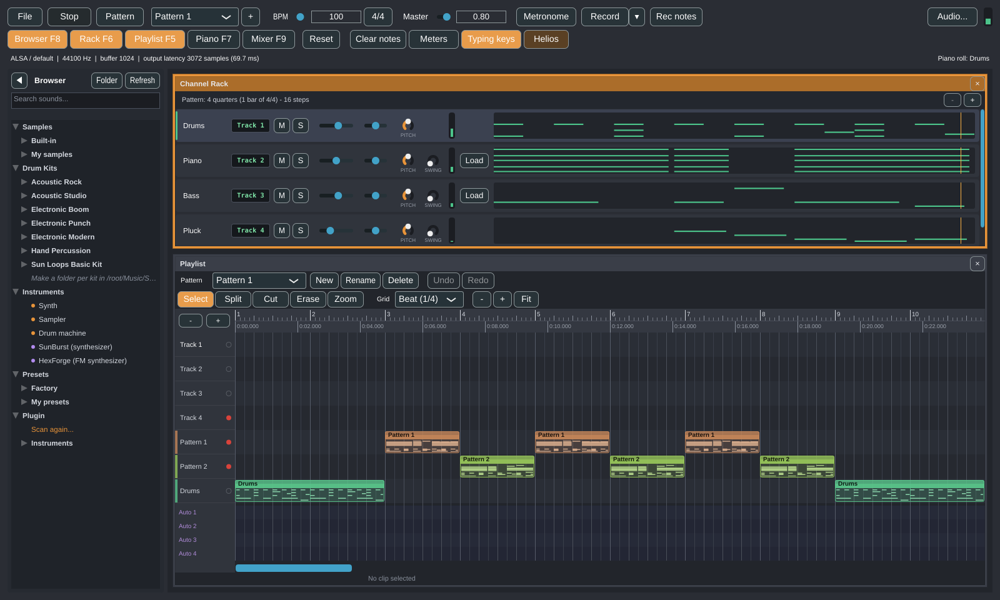
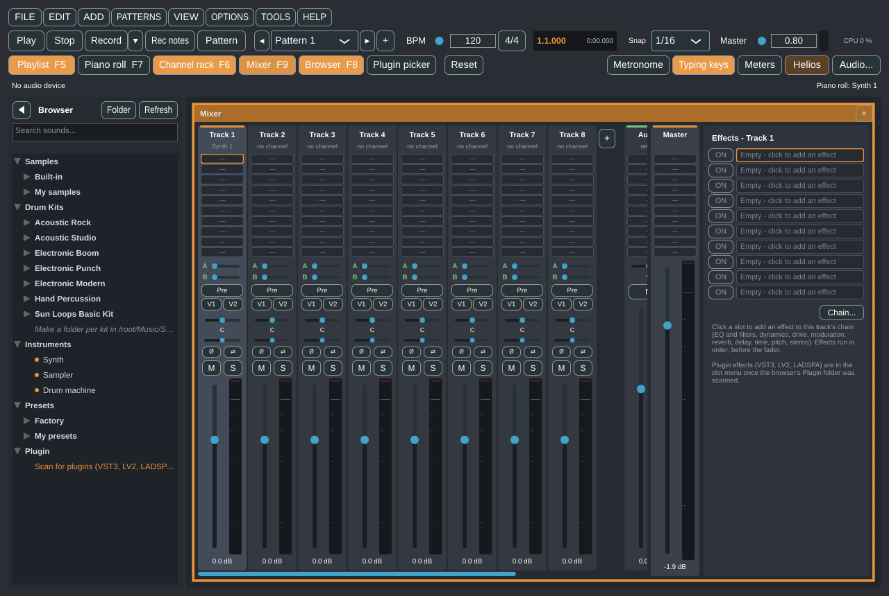

# Sun Loops Studio

*[English](README.md)*

Un programma open source per produrre musica a loop su Linux, scritto in C++20 con JUCE 8. Costruisci ritmi e
melodie nel **Channel Rack**, scrivi le note nel **Piano Roll**, disponi i pattern nella **Playlist** (insieme a file audio e registrazioni), bilanciali nel
**Mixer** con effetti ed esporti il risultato in WAV, MP3, Ogg, AAC, FLAC o AIFF. Un **Browser** a sinistra raccoglie i tuoi suoni; ogni altro
strumento sta in un pannello mobile che puoi spostare, ridimensionare, sovrapporre, aprire e chiudere.





Sun Loops Studio si ispira al modo di lavorare dei DAW a loop come FL Studio. È un progetto indipendente: non usa
codice, nomi, grafica o risorse di altri prodotti e non è affiliato né approvato dai loro produttori.

**Stato: alpha (0.49.0).** Compila, i test automatici passano e l'interfaccia è stata provata in un display virtuale.
La riproduzione è stata confermata su un vero PC Nobara per la versione 0.3; tutto ciò che è stato aggiunto dopo
(pannelli, pattern, playlist, browser, pitch/swing, mixer espanso ed effetti, salvataggio dei progetti, AppImage, clip audio, trascinamento
dei file, registrazione, MIDI, metronomo e formati di esportazione) è stato provato con test automatici e in un display virtuale con un
dispositivo audio muto, non ancora con audio reale, microfoni o hardware MIDI. **Dalla 0.17.0 si possono usare i plugin (VST3, LV2,
LADSPA)** come strumenti e come effetti del mixer; sono stati provati con piccoli plugin di prova e con gli esempi LADSPA, non ancora con
plugin commerciali. Vedi [docs/roadmap.md](docs/roadmap.md) per sapere con precisione cosa è verificato, cosa no e cosa manca.

## Funzioni

- **Pannelli mobili** - Channel Rack, Playlist, Piano Roll e Mixer. Si trascinano dalla barra del titolo, si
  ridimensionano dai bordi, si chiudono con la ×, il doppio clic sul titolo li massimizza. I pannelli si
  sovrappongono; un clic su uno lo porta davanti. `F5` / `F6` / `F7` / `F9` aprono, portano davanti o chiudono
  Playlist / Rack / Piano Roll / Mixer. La disposizione viene ricordata.
- **Browser** (barra laterale a sinistra, `F8` la ripiega) - un albero con *Samples*, *Drum Kits*, *Instruments*,
  *Presets* e *Plugin*, una casella di ricerca rapida e il trascinamento (o il doppio clic) dei suoni su un canale
  del Channel Rack. I tuoi file stanno in `~/Music/Sun Loops Studio/`.
- **Channel Rack** - fino a 32 canali, ognuno synth, sampler o drum machine. Sequencer a step da 16esimi come in FL Studio
  (0.31.0): ogni nuovo canale parte con i quadratini (clic sinistro scrive, destro cancella); la griglia è esattamente il pattern - una
  battuta in 4/4, 16 step, in un progetto nuovo - e i pulsanti **-** / **+** del rack tolgono o aggiungono **un quarto** alla volta (0.42.0); appena il Piano Roll
  scrive altre note la riga ne mostra l'anteprima (un clic apre il Piano Roll), e cancellandole tornano i quadratini. Per canale: volume, pan, manopola **Pitch** (semitoni), manopola **Swing** e
  un display **Track N** che manda il canale a una traccia del mixer. Tasto destro su un canale: *Piano roll*,
  *Instrument*, *Load sample...*, *Rename...*, *Clone*, *Move up / down*, *Delete*, *Assign free mixer track*, *Save as preset...*.
- **Piano Roll** - per il canale selezionato: clic per aggiungere una nota, trascina per spostarla, trascina il bordo
  destro per ridimensionarla, tasto destro per eliminarla, scorrimento e zoom. Si apre da un canale (menu o doppio
  clic), come in FL Studio. **Dalla 0.23.0**: selezioni (dalla 0.44.0 un trascinamento sulle celle vuote disegna un rettangolo di selezione; Ctrl+A), copia / incolla / duplica (anche tra i piano roll di canali diversi), spostamento con le
  frecce, snap da battute a 1/32 e terzine, una **scala** mostrata sulla griglia (con snap alla scala), **accordi posati con un clic**,
  una **corsia della velocity**, strumenti di modifica (quantize, humanize, legato, staccato, strum, arpeggio, chop, flip, rampe di
  velocity) e **generatori** di progressioni di accordi e linee di basso (anche seguendo gli accordi di un altro canale).
- **Progetti FL Studio** (0.34.0) - *File* apre un .flp come nuovo progetto (tempo, canali e campioni, note dei pattern, playlist,
  nomi e colori delle tracce) e ne esporta uno; il formato nativo resta .slp. Codice scritto per questo programma, niente di FL Studio.
- **Tastiera del computer** (0.32.0) - la tastiera del computer suona il canale selezionato: A S D F... da C5 (nomi delle
  note come in FL Studio, MIDI 60 = C5), Z / X per l'ottava, C / V per la velocity; Rec notes la registra come una tastiera MIDI.
- **Loop Starter** (0.30.0) - un loop di partenza in uno di dieci generi (house, techno, hip-hop, trap, drum & bass, pop, lo-fi,
  reggaeton, rock, synthwave): batteria, basso, accordi e una melodia che stanno insieme, nella tonalità scelta, al tempo del genere, con
  i suoni incorporati, come nuovo pattern. Fatto con regole e caso (niente IA, niente in rete); ogni variante è diversa.
- **Pattern e Playlist** - più pattern (nuovi, copiati, rinominati o eliminati con i pulsanti sopra la playlist) disposti come clip su tracce (0.44.0: 4 tracce libere più una per ogni pattern, aggiunta da sola a ogni nuovo pattern, e **-** / **+** per togliere o aggiungere tracce a mano, fino a 128; ognuna con nome e colore propri, e le clip possono stare una sopra l'altra: 0.33.0). Il pulsante *Pattern / Song*
  sceglie se ripetere il pattern selezionato o suonare tutta la playlist; i pattern durano da 4 a 64 quarti, e le clip di pattern si spostano per quadrati della griglia (o liberamente con Alt), quindi possono partire sfasate tra loro (0.42.0). **Clic sul righello per spostare il
  cursore, anche in riproduzione; trascinamento col destro per disegnare una zona di loop** (tasto destro sulla zona per spostarla, ridimensionarla o eliminarla).
- **Audio nella Playlist** - trascina file audio (`.wav .aiff .flac .ogg .oga .mp3 .aac`) o video (ne viene presa la
  traccia audio) dal file manager sulla Playlist: diventano clip con la forma d'onda. Gli **strumenti Select, Split, Cut, Erase e Zoom**,
  il ritaglio dai due bordi, una griglia fino al singolo tick, annulla/ripristina e un righello in minuti:secondi.millisecondi
  con la lettura del tempo sotto il mouse permettono di lavorare con precisione su una registrazione. AAC e l'audio dei video richiedono `ffmpeg` installato.
- **Registrazione** - il pulsante **Record** registra un microfono o uno strumento nella traccia di playlist che scegli,
  a tempo con il brano; **dalla 0.36.0** più tracce insieme, ognuna dal proprio ingresso (mono o una coppia stereo), e dal
  marcatore di inizio (punch-in); **dalla 0.47.0** con count-in, una take per ogni passaggio di una regione di loop, o punch-out. Le **tastiere MIDI** suonano il canale selezionato e **Rec notes** scrive nel piano roll (quantizzato) ciò che suonano, per
  fare pattern; una registrazione può anche diventare un nuovo canale sampler. Si imposta in **Audio...**.
- **Suoni incorporati** (0.22.0) - un **pianoforte a coda** campionato (Salamander, 4 livelli di velocity), un **basso elettrico**
  campionato (Growlybass, 4 livelli di velocity, più una versione staccato), due **kit di batteria acustica** campionati (dalle
  registrazioni DrumGizmo: Acoustic Studio e Acoustic Rock, 16 pezzi con fino a 4 livelli di velocity), tre **kit elettronici** e un
  kit di **percussioni a mano** generati dal codice del programma, tutti con livelli di velocity e nell'ordine General MIDI. Presets >
  Factory > Keys / Bass; i kit sono in Drum Kits nel browser e nel menu *Load kit...* della drum machine. Il progetto dimostrativo li
  usa; all'apertura suona un suono di avvio (si disattiva nel menu File). Licenze: [resources/sounds/README.md](resources/sounds/README.md).
- **Importazione MIDI, legato e slide, annulla per le note** - un file MIDI standard (menu File, o trascinato sulla Playlist) diventa
  nuovi canali e pattern; le note si possono unire con **legato** o con uno **slide** di altezza (Maiusc+clic nel Piano Roll); **Ctrl+Z / Ctrl+Y**
  annullano e ripristinano qualsiasi modifica (note, canali, kit, mixer, pattern; la Playlist ha anche il suo annulla per le clip).
- **Sicurezza** - salvataggio automatico ogni minuto, recupero dopo un crash, un `.bak` della versione precedente ed *Export project with samples*
  per portare un progetto su un altro computer.
- **Metronomo** - un click con tempo (anche tap tempo) e volume regolabili, su un pulsante a parte.
- **Metro e cambi di tempo** (0.46.0) - da 2/4 a 7/4, 6/8 e 12/8 per le battute, la griglia e l'accento del metronomo; cambi di
  tempo nel brano (a gradino, come i tempo marker di FL Studio) mostrati come bandierine nel righello e seguiti dalla modalità Song e dalle esportazioni.
- **Synth** - ogni canale synth può passare dal seno classico a un **synth sottrattivo**: due oscillatori a banda limitata e rumore, un filtro
  da 12 o 24 dB con il suo inviluppo, un inviluppo di ampiezza e un LFO, oppure a un **synth FM** con quattro operatori e una matrice di
  modulazione (feedback, otto algoritmi classici), a un **synth additivo** (0.24.0: fino a 64 armoniche, due timbri con formanti e un
  morphing fra loro, un filtro che agisce sulle armoniche e quindi non produce aliasing) o a un **modello fisico** (0.24.0: corda
  pizzicata con smorzamento, rigidità e cassa armonica; marimba, vibrafono, vetro, campana, lastra di metallo); 29 suoni pronti,
  raggruppati per motore (anche come preset nel browser).
- **SunBurst** (0.48.0) - un sintetizzatore polifonico in forma di plugin (VST3 e Standalone) incluso col programma: tre oscillatori con
  wavetable a banda limitata e fino a 16 voci di unison ("fat saw"), sub e rumore, filtro multimodo, tre inviluppi, tre LFO, una
  matrice di modulazione a 16 slot, quattro macro, distorsione / EQ / filtro / chorus / delay / riverbero, arpeggiatore, finestra in
  stile hardware e 101 preset (lead, pad, archi, bassi, arpeggi, pluck, tastiere, FX). Browser > Instruments > SunBurst.
- **Plugin** - strumenti ed effetti VST3, LV2 e LADSPA: si cercano dal browser, doppio clic o trascinamento di uno strumento per un canale,
  un effetto si sceglie in uno slot del mixer, ognuno ha la sua finestra; le impostazioni si salvano nel progetto, anche se il plugin manca.
- **Mixer** (`F9`) - 8 tracce verticali all'inizio e fino a **500** (0.29.0: il **+** dopo l'ultima traccia ne aggiunge altre), ognuna con fader e dB, bilanciamento stereo, mute, solo, indicatore
  Peak/RMS e 10 slot per effetti in serie (0.45.0; con preset di catene) (14 effetti interni con preset: Equalizer, Parametric EQ, Filter, Compressor, Maximizer, Transient, Overdrive, Chorus, Phaser, Reverb Hall/Room/Plate, Delay Stereo/Ping-pong/Tape, Time Shaper (tipo Gross Beat), Pitch Corrector (tipo Pitcher), Stereo Imager; con bypass), due **send** (pre o post fader)
  e due interruttori **VCA**. Accanto alle tracce ci sono due **bus aux** con effetti propri e due **gruppi VCA**. La strip master a destra
  ha gli stessi 10 slot, applicati a tutto il mix. Il Compressor ha un ingresso **sidechain** da qualsiasi traccia (0.45.0). Più canali possono usare la stessa traccia.
- **Automazione** - tasto destro su volume, pan, fader o parametro di un effetto > *Create automation clip*; le clip stanno su quattro
  corsie sotto le tracce della playlist e hanno un editor dei punti (linee lineari / a gradino / morbide). Solo in modalità Song.
  **Dalla 0.35.0** anche i parametri dei plugin VST3 / LV2 / LADSPA, scelti da un elenco filtrabile con quello mosso per ultimo nella
  finestra del plugin già selezionato.
  **Dalla 0.47.0** anche send, bus aux e gruppi VCA, e i controlli si muovono con la loro automazione mentre il brano suona.
- **Stretch e pitch** - tasto destro su una clip audio: allungala o accorciala senza cambiarne l'intonazione, trasponila senza cambiarne la lunghezza,
  o adatta un loop al tempo del progetto (Signalsmith Stretch).
- **Sampler e SoundFont** - inviluppo (ADSR), loop, filtro passa-basso / passa-alto / passa-banda e nota di base per ogni canale sampler; i preset
  **SoundFont 2 (.sf2)** e (dalla 0.41.0) gli strumenti **SFZ** suonati come zone multi-campione; le slice dell'editor di campioni diventano un canale sampler con una nota per slice.
- **Slicer** (0.37.0) - un loop tagliato in slice come in Slicex (per suono, a griglia o in parti uguali), un tasto per slice, ognuna
  con intonazione, livello, pan e verso propri, e le note che lo suonano seguendo il tempo del progetto.
- **Editor di intonazione** (0.38.0) - una linea cantata o suonata come note sopra la curva dell'intonazione (come Newtone): sposta
  le note, intonale sul tasto o su una scala, salva l'audio intonato, o trasforma la linea in note di un canale.
- **Stem** (0.39.0) - un mix diviso in batteria, basso e il resto con l'elaborazione del segnale (senza IA), le tre parti che
  sommate danno l'originale.
- **Helios** (0.40.0) - F1: chiedi come fare qualcosa in italiano o in inglese; cerca nel manuale integrato ed esegue comandi, senza
  rete.
- **Report dei crash e aggiornamenti** (0.43.0) - un log di sessione (spdlog, ruotato a 5 MB); dopo un crash (SIGSEGV, SIGABRT, SIGFPE...)
  il successivo avvio propone di inviare a GitHub, come issue, un report anonimo con stack trace e sistema (o di mostrarlo prima, o di
  eliminarlo); un controllo in background di una release più recente (Semantic Versioning), disattivabile. Nulla viene inviato senza un clic.
- **Drum machine** - un canale con 16 pad (note da 36 a 51): fino a quattro layer di suono per pad scelti dalla velocità, volume, pan, intonazione, swing e
  choke group per pad, un sequencer a passi con una riga per pad, trascinamento dal browser e kit salvati come cartelle (`kit.json` + suoni).
- **Editor di campioni** - tasto destro su una clip audio o su un canale sampler > *Edit sample...*: forma d'onda con zoom e selezione, anteprima con spettro in tempo reale,
  taglia / ritaglia / silenzia / inverti / guadagno / normalizza / dissolvenze / rimozione DC con annulla, riduzione del rumore (spectral gating) e taglio di una clip
  sui colpi rilevati o in parti uguali. Il risultato è salvato come nuovo file WAV; l'originale non viene mai toccato.
- **Misuratori** - loudness in LUFS (momentaneo, breve, integrato, range; EBU R128), true peak, analizzatore di spettro, goniometro e correlazione.
- **Sampler** - carica file WAV, FLAC, OGG e AIFF (fino a 30 s), li suona una volta sola, ritonati in base alla nota.
  Cassa, rullante e hi-hat sono sintetizzati: non servono file per iniziare.
- **Progetti** - menu `File` e `Ctrl+N` / `Ctrl+O` / `Ctrl+S` / `Ctrl+Maiusc+S`: *Save* scrive un progetto con nome;
  un progetto che non ha ancora un nome viene salvato subito con un nome automatico (`Untitled <data ora>.slp`)
  in `~/Music/Sun Loops Studio/Projects`, così non si perde nulla; *Save as...* chiede il nome. Progetti recenti,
  barra del titolo con il nome e `*` per le modifiche non salvate, avviso prima di chiudere con lavoro non
  salvato. I sample sono referenziati con il percorso, non copiati nel file.
- **Esportazione** - *File > Export audio*: pattern o brano in WAV, AIFF, FLAC (senza perdita) oppure MP3, Ogg Vorbis
  (`.ogg` / `.oga`), AAC (con perdita), generato dallo stesso motore che lo suona. MP3 e AAC richiedono `ffmpeg`. Dalla 0.45.0 si scelgono frequenza (44,1 - 96 kHz), bit (16 con dither, 24, 32 float) o bitrate, titolo e artista, e gli **stem**
  (un file per traccia del mixer).
- **Audio** - scelta del dispositivo, **buffer** regolabile (predefinito 1024 campioni) e un tasto **Auto** che prova
  il tuo computer e sceglie una dimensione che non gracchia, più la lettura di carico e blocchi persi. La scelta viene
  ricordata.

## Avvio rapido (Nobara / Fedora)

```bash
git clone https://github.com/Hubert9204/Sun-Loops-Studio.git
cd Sun-Loops-Studio
./scripts/setup_nobara.sh                      # installa le dipendenze (chiede sudo)
cmake -B build -G Ninja -DCMAKE_BUILD_TYPE=Release
cmake --build build
./build/SunLoopsStudio_artefacts/Release/"Sun Loops Studio"
```

Alla prima configurazione CMake scarica JUCE 8.0.4 (serve la rete una volta). Per metterlo nel menu delle
applicazioni: `cmake --install build --prefix ~/.local`. Per creare un'unica **AppImage**
(`dist/Sun-Loops-Studio-<versione>-x86_64.AppImage`): `./scripts/build_appimage.sh`. Altri dettagli e risoluzione dei problemi:
[docs/building.md](docs/building.md) (in inglese).

**Spazio** per suonare, **F5 / F6 / F7 / F9** per i pannelli e **F8** per il browser. Una guida all'uso è in
[docs/user-guide.it.md](docs/user-guide.it.md).

## Documentazione

| Documento | Contenuto |
| --- | --- |
| [docs/user-guide.it.md](docs/user-guide.it.md) | Come usare ogni pannello, scorciatoie, limiti ([English](docs/user-guide.md)) |
| [docs/building.md](docs/building.md) | Dipendenze, build, installazione, test, problemi comuni (inglese) |
| [docs/architecture.md](docs/architecture.md) | Thread, regole real-time, flusso dei dati, pattern e playlist, pannelli, test (inglese) |
| [docs/roadmap.md](docs/roadmap.md) | Cosa è verificato, cosa no, cosa viene dopo (inglese) |
| [CHANGELOG.md](CHANGELOG.md) | Modifiche per versione (inglese) |

## Test

```bash
./build/SunLoopsStudioTests_artefacts/Release/SunLoopsStudioTests
```

Non servono dispositivo audio né display. Controllano, tra l'altro, intonazione del synth e tempi esatti al
campione, loop, polifonia, tracce del mixer, pitch e swing, i quattro effetti, sampler, che `Player::render` non
allochi mai memoria (effetti compresi), uno stress test concorrente del passaggio dati interfaccia→audio, andata e
ritorno WAV, lo scanner dei plugin, l'albero e la scansione del browser, i preset dei canali, le regole dei pannelli, la
playlist, le note dal vivo e il file di progetto (andata e ritorno, file danneggiati o ostili, sample mancanti,
scrittura atomica), l'esportazione in ogni formato, l'importazione di audio e video, le clip audio, il registratore,
la gestione delle note MIDI e il metronomo.

## Licenza

Dalla 0.34.0 Sun Loops Studio è software libero con licenza **GNU Affero General Public License, versione 3** (AGPLv3,
[LICENSE](LICENSE)); le versioni dalla 0.17.0 alla 0.33.0 erano pubblicate con la GNU GPL versione 3 e quelle fino alla 0.16.0 con
licenza MIT. Anche JUCE 8, su cui il programma è costruito, è offerto gratuitamente con la AGPLv3, quindi le due licenze ora
coincidono. Se modifichi il programma e lo fai usare ad altri attraverso una rete (per esempio un controllo remoto), devi offrire
anche a loro il sorgente della tua versione (sezione 13 della licenza).

Il supporto dei progetti FL Studio (`src/library/FlpFile.*`, `FlpProject.*`) è codice scritto per questo programma con la stessa
licenza; non usa codice né librerie di FL Studio, solo la struttura del file come documentata dalla comunità del software libero. Il programma e
la sua AppImage si possono condividere purché siano accompagnati dal codice sorgente.

`third_party/signalsmith` contiene Signalsmith Stretch e Signalsmith Linear, entrambe con licenza MIT (le licenze e le revisioni esatte sono in quella cartella).
`third_party/tinysoundfont` contiene `tsf.h` di TinySoundFont (MIT), usato solo per leggere i file SoundFont.
Le registrazioni incorporate mantengono le loro licenze: Salamander Grand Piano di Alexander Holm (CC BY 3.0), Growlybass di Karoryfer
Lecolds (CC0), DrumGizmo MuldjordKit di Lars Muldjord e DRSKit del team DrumGizmo (CC BY 4.0); vedi
[resources/sounds/README.md](resources/sounds/README.md) e [tools/sounds](tools/sounds/README.md) per come sono state preparate.
