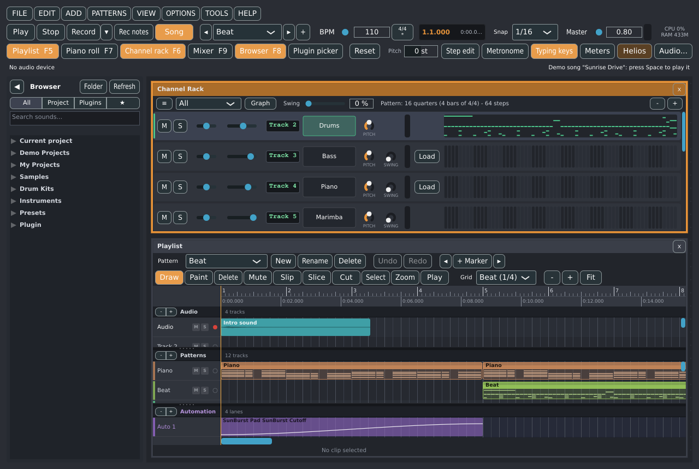
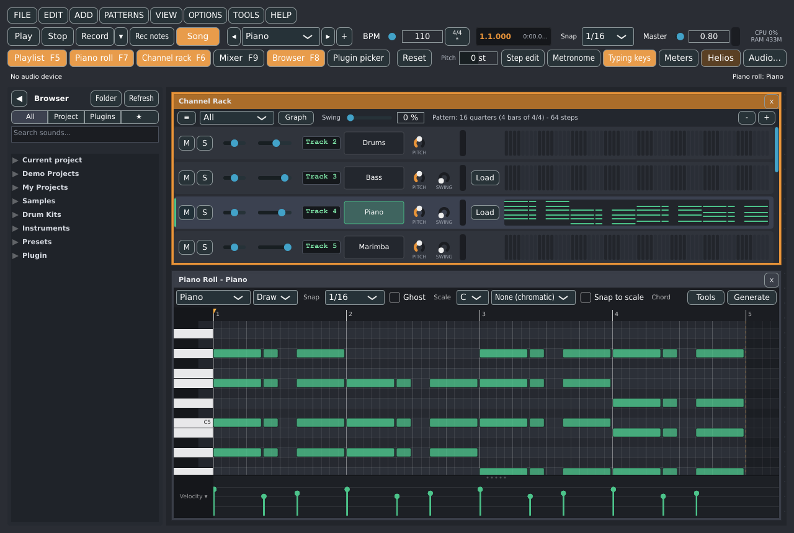
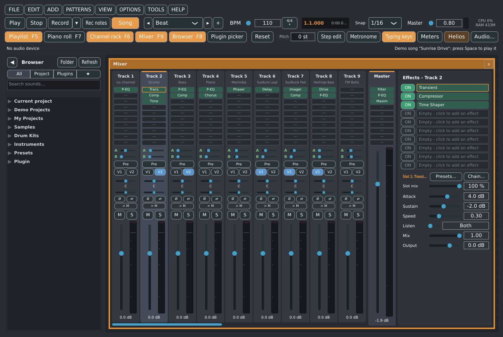
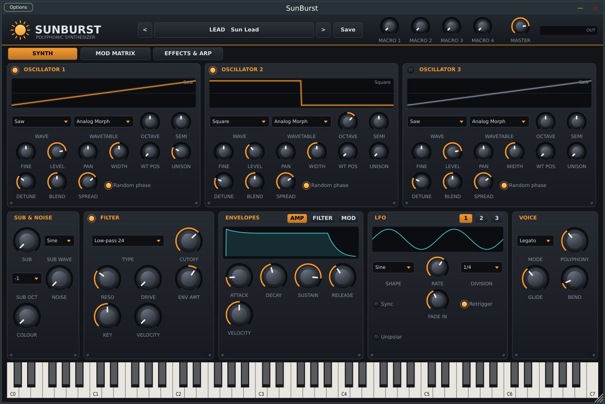
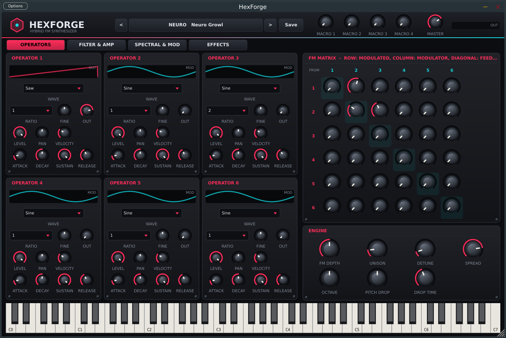
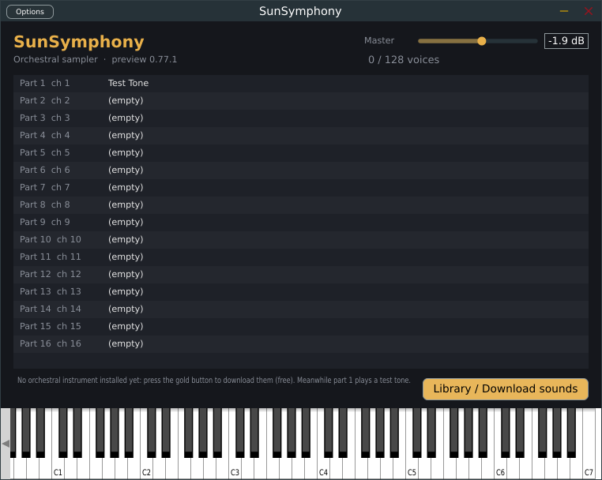
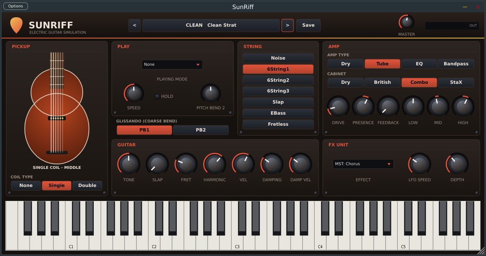

# Sun Loops Studio

*[English](README.md)*

Un programma open source per produrre musica a loop su **Linux, macOS e Windows**, scritto in C++20 con JUCE 8. Costruisci
ritmi e melodie nel **Channel Rack**, scrivi le note nel **Piano Roll**, disponi pattern, audio e automazioni sulla
**Playlist**, li bilanci nel **Mixer** con gli effetti ed esporti il risultato in WAV, MP3, Ogg, AAC, FLAC o AIFF. Un
**Browser** a sinistra contiene i tuoi suoni; ogni altro strumento sta in un pannello mobile che puoi spostare, ridimensionare,
sovrapporre, aprire e chiudere. Con il programma arrivano quattro strumenti: i sintetizzatori **SunBurst** e **HexForge**, la
chitarra elettrica **SunRiff** e il campionatore orchestrale **SunSymphony**.



| | |
| --- | --- |
|  |  |
| **Piano Roll** - scale, accordi, corsie di velocity ed eventi, strumenti di modifica, generatori | **Mixer** - fino a 500 tracce, 10 slot di effetti ciascuna, mandate, bus aux, gruppi VCA |
|  |  |
| **SunBurst** - sintetizzatore wavetable, 101 preset | **HexForge** - sintetizzatore ibrido FM + sottrattivo, 40 preset |
|  |  |
| **SunSymphony** - campionatore orchestrale, 16 parti, 29 strumenti scaricabili | **SunRiff** - chitarra elettrica modellata con ampli ed effetti, 34 preset |

## Download

L'ultima release per tutti e tre i sistemi ([tutti i file, i checksum e le versioni precedenti](https://github.com/Hubert9204/Sun-Loops-Studio/releases/latest)):

| Sistema | Download | Requisiti |
| --- | --- | --- |
| **Linux** | [Sun-Loops-Studio-x86_64.AppImage](https://github.com/Hubert9204/Sun-Loops-Studio/releases/latest/download/Sun-Loops-Studio-x86_64.AppImage) | PC a 64 bit, glibc 2.40 o più recente (Fedora / Nobara 41+, Ubuntu 24.10+, Debian 13+, Arch...) |
| **macOS** | [Sun-Loops-Studio-macOS.dmg](https://github.com/Hubert9204/Sun-Loops-Studio/releases/latest/download/Sun-Loops-Studio-macOS.dmg) | macOS 10.15 Catalina o successivo; una sola app per Mac Apple silicon e Intel (dal 2012 in poi) |
| **Windows** | [Sun-Loops-Studio-Windows-x64-Setup.exe](https://github.com/Hubert9204/Sun-Loops-Studio/releases/latest/download/Sun-Loops-Studio-Windows-x64-Setup.exe) (installer) o [Sun-Loops-Studio-Windows-x64.zip](https://github.com/Hubert9204/Sun-Loops-Studio/releases/latest/download/Sun-Loops-Studio-Windows-x64.zip) (senza installazione) | Windows 10 o 11, 64 bit |

Questi link portano sempre alla release più recente. Nella pagina della release gli stessi file hanno la versione nel nome
(`Sun-Loops-Studio-<versione>-x86_64.AppImage`...), accanto a `SHA256SUMS*.txt` con i loro checksum. Ogni download contiene il
programma, i suoi suoni e i suoi quattro strumenti; l'orchestra di SunSymphony (3 GB) si scarica dall'interno.

**Linux** - rendi eseguibile l'AppImage e avviala:

```bash
chmod +x Sun-Loops-Studio-x86_64.AppImage
./Sun-Loops-Studio-x86_64.AppImage
```

Senza FUSE 2 non parte: installalo una volta (Fedora / Nobara: `sudo dnf install fuse-libs`; Ubuntu / Debian: `sudo apt
install libfuse2t64` o `libfuse2`) oppure avviala con `--appimage-extract-and-run`. Al primo avvio si aggiunge al menu delle
applicazioni e dà la sua icona ai file di progetto `.slp`.

**macOS** - apri l'immagine disco e trascina **Sun Loops Studio** su **Applicazioni**. L'app non è firmata con un certificato Apple
Developer, quindi la prima volta macOS si rifiuta di aprirla: tasto destro (o Ctrl-clic) sull'app > **Apri** > **Apri**, oppure
*Impostazioni di Sistema > Privacy e sicurezza > Apri comunque* (l'unico modo da macOS 15 Sequoia in poi). La registrazione chiede
una volta il permesso per il microfono. Altro: [Su un Mac](docs/user-guide.it.md#su-un-mac-0630).

**Windows** - l'installer installa solo per te senza password di amministratore (o per tutti, se lo scegli), aggiunge una voce
nel menu Start, apre i progetti `.slp` con un doppio clic e può copiare i quattro strumenti nella cartella VST3 per gli altri
programmi musicali; *Impostazioni > App* lo disinstalla. Lo zip è lo stesso programma senza installazione: estrailo dove vuoi e
avvia `Sun Loops Studio.exe`. Il programma non è firmato con un certificato di firma del codice, quindi SmartScreen può fermare
il primo avvio: **Ulteriori informazioni** > **Esegui comunque**. Le schede audio si aprono con il loro driver **ASIO** in modo
predefinito (Windows Audio quando non ce n'è uno). Altro: [Su Windows](docs/user-guide.it.md#su-windows-0750).

Qualche secondo dopo l'avvio il programma controlla se c'è una release più recente (*Help > Check for updates now* lo fa subito;
il controllo automatico si può spegnere) e propone il download per il tuo sistema. Per compilarlo da te vedi
[Compilare dal sorgente](#compilare-dal-sorgente).

**Community:** entra nel [Discord di Sun Loops](https://discord.gg/VwzdD6tRNB) per fare domande, segnalare problemi e condividere la
tua musica (anche dal programma: *Help > Join the Sun Loops Discord*).

Sun Loops Studio si ispira al modo di lavorare dei DAW a loop come FL Studio. È un progetto indipendente: non usa codice, nomi,
grafica o risorse di altri prodotti e non è affiliato né approvato dai loro produttori.

## Stato

**Alpha - versione 0.77** (novembre 2026). Si può usare per fare musica, ma non è ancora stato provato a fondo su hardware vero.

- **Test automatici**: circa **2.130 controlli** passano a ogni push su tutti e tre i sistemi - Fedora 41, macOS (Apple silicon, e
  Intel tramite Rosetta) e Windows - in GitHub Actions. Su Windows l'integrazione continua avvia anche il programma dallo zip, lo
  installa, avvia e disinstalla con l'installer, e carica un vero driver ASIO (FlexASIO).
- **Linux** è il sistema su cui il programma è nato: l'AppImage gira su Nobara e la riproduzione è stata confermata su un PC vero.
  Gran parte delle funzioni arrivate dopo (registrazione, hardware MIDI, plugin, il suono degli strumenti) è stata provata con test
  automatici e in un display virtuale con un dispositivo audio muto.
- **macOS** (dalla 0.63.0) e **Windows** (dalla 0.75.0, ASIO dalla 0.76.0) nascono dallo stesso codice e passano gli stessi test,
  ma non sono ancora stati provati a mano su computer veri; le segnalazioni sono benvenute.
- **I plugin** sono stati provati con piccoli plugin di prova, con gli esempi LADSPA e con i quattro strumenti del programma, non
  ancora con plugin commerciali.

Cosa è verificato e cosa no, funzione per funzione: [docs/roadmap.md](docs/roadmap.md). Le modifiche di ogni versione:
[CHANGELOG.md](CHANGELOG.md).

## Funzioni

### Fare musica

- **Channel Rack** - fino a 32 canali, ognuno synth, sampler, drum machine, livello di altri canali (Layer) o plugin. Sequencer a
  step da 16esimi come in FL Studio, con un editor grafico per step (velocity, pan, release, intonazione fine, mod X / Y, shift),
  gruppi, colori, icone, e per canale volume, pan, pitch, swing e una traccia del mixer.
- **Piano Roll** - strumenti disegno, pittura, mute, taglio e riproduzione, selezioni; snap dalle battute a 1/32 e alle terzine;
  una **scala** sulla griglia, **accordi** con un clic, corsie di **velocity** ed eventi (pan, release, intonazione fine, mod
  X / Y), quantizzazione, humanize, legato, strum, arpeggio, chop, flip, glue, flam, claw machine e **generatori** di giri di
  accordi e linee di basso. La tastiera del computer e le tastiere MIDI suonano e registrano.
- **Pattern e Playlist** - pattern ognuno della sua lunghezza, disposti su una Playlist in tre sezioni (**Audio**, **Pattern**,
  **Automazione**; una traccia per pattern, aggiunta ed eliminata con lui) con gli strumenti disegno, pittura, cancella, mute, slip, taglio, cut, selezione, riproduzione e zoom, marker
  di tempo, una regione di loop, mute / solo per traccia, icone e colori. Riproduzione *Pattern* o *Song*.
- **Clip audio e registrazione** - trascina audio (`.wav .aiff .flac .ogg .oga .mp3 .aac`) o il suono di un video sulla Playlist;
  allungali e cambiane l'intonazione (Signalsmith Stretch), modificali nell'**editor dei campioni** (taglio, dissolvenze,
  inversione, normalizzazione, riduzione del rumore, slicing). **Registra** più ingressi insieme nella playlist, con conteggio,
  take in loop, punch in / out, e note MIDI in sovrapposizione o sostituzione.
- **Automazione** - clip per qualsiasi volume, pan, fader, mandata, parametro di effetto o di plugin, con un editor a punti; cambi
  di tempo e tempi in chiave da 2/4 a 12/8.
- **Performance mode** - le clip della Playlist come celle da lanciare dal vivo (loop, one shot, hold), col mouse o con pad MIDI.
- **Loop Starter** - un loop di partenza in uno di dieci generi (batteria, basso, accordi e melodia), fatto con regole e caso,
  senza rete.
- **File di FL Studio e MIDI** - apre ed esporta progetti `.flp` (codice scritto per questo programma, nessun codice di FL
  Studio); importa file MIDI standard. Il formato nativo è `.slp`.

### Suono

- **Motori di sintesi integrati** - sottrattivo, FM a 4 operatori, additivo, modelli fisici (corde, percussioni a lamine,
  campane) e un **synth di batteria** (cassa, rullante, tom, clap, hi-hat, piatto), con suoni pronti.
- **Sampler** - inviluppi ADSR e per destinazione, due LFO, filtri, loop, reverse, modi di riproduzione **granulare** e **a
  curva di percorso**, un **sintetizzatore vocale** che trasforma un testo scritto in un campione; strumenti **SoundFont 2** e
  **SFZ**; uno **slicer**; una **drum machine** con 16 pad e livelli di velocity; un **editor di intonazione** per le linee
  cantate; **stem** (batteria, basso, il resto) con l'elaborazione del segnale.
- **Suoni integrati** - un Grand Piano e un basso elettrico campionati, due batterie acustiche campionate, tre kit elettronici e
  un kit di percussioni a mano ([licenze](resources/sounds/README.md)).
- **Mixer** - da 8 a 500 tracce (si aggiungono in fondo, se ne elimina una qualsiasi: tutto ciò che va alle altre le segue), ognuna con fader, pan, separazione stereo, polarità, mute / solo, misuratori, **10 slot di
  effetti** con manopola di mix, 8 mandate (pre o post fader), instradamento libero, un ritardo di traccia e la compensazione
  della latenza dei plugin; fino a otto bus aux (+ e - nel mixer) e due gruppi VCA; una striscia master.
- **36 effetti e controller integrati** - equalizzatori, filtri, compressori e un compressore multibanda, maximizer, gate,
  overdrive, wave shaper, chorus, flanger, phaser e le loro versioni vintage, delay, riverberi e un riverbero a convoluzione,
  vocoder, correttore di intonazione, time shaper, scratcher, granulare, frequency shifter, stereo imager, il **Patcher** (dieci
  effetti in uno slot) e i controller peak, envelope e formula. Con preset e preset di catena.
- **Misuratori** - loudness in LUFS (EBU R128), true peak, spettro, goniometro e correlazione.
- **Esportazione** - il pattern o il brano in WAV, AIFF, FLAC, MP3, Ogg Vorbis o AAC, da 44,1 a 96 kHz, 16 / 24 / 32 bit, con i
  tag, e **stem** (un file per traccia del mixer). MP3 e AAC richiedono `ffmpeg`.

### I quattro strumenti

| Strumento | Che cos'è |
| --- | --- |
| **SunBurst** (0.48.0) | Sintetizzatore wavetable polifonico: 3 oscillatori con fino a 16 voci unison, sub e rumore, filtro multimodo, 3 inviluppi, 3 LFO, una matrice di modulazione a 16 slot, 4 macro, effetti, arpeggiatore, 101 preset |
| **HexForge** (0.50.0) | Sintetizzatore ibrido FM + sottrattivo per suoni aggressivi e metallici: 6 operatori, 32 onde più 2 onde spettrali disegnabili, una matrice FM 6 x 6, filtro ladder, unison, effetti, 40 preset |
| **SunSymphony** (0.66.0, anteprima) | Campionatore orchestrale multitimbrico: 16 parti sui 16 canali MIDI, 128 voci, strumenti SFZ; la sua pagina Library scarica 29 strumenti orchestrali (3 GB, suoni CC0 di Versilian Studios) con un clic |
| **SunRiff** (0.68.0) | Chitarra elettrica con i controlli di FL Slayer: corde a modello fisico, un pickup spostabile, modi accordo, strum, power chord e slide, un ampli valvolare, 4 casse, 15 effetti, 34 preset |

**Come sono compilati.** Ogni strumento è un plugin a sé, non codice compilato dentro il programma: `CMakeLists.txt` li crea con
`juce_add_plugin(... FORMATS VST3 Standalone)`, che dà due target CMake per strumento - `SunBurst_VST3` e `SunBurst_Standalone`
(allo stesso modo `HexForge_*`, `SunSymphony_*`, `SunRiff_*`) - attivi in modo predefinito con `SLS_BUILD_SUNBURST`,
`SLS_BUILD_HEXFORGE`, `SLS_BUILD_SUNSYMPHONY` e `SLS_BUILD_SUNRIFF`. Compilare il programma (`SunLoopsStudio`) compila anche i
quattro plugin **VST3**, e il programma li carica come qualsiasi altro plugin VST3, da accanto a sé e senza scansione (Browser >
Instruments). Il loro codice DSP è compilato anche nel programma dei test, per provarli senza interfaccia.

- **Nei download**: i quattro plugin **VST3** - dentro l'AppImage (`usr/lib/vst3`), dentro l'app per Mac
  (`Contents/PlugIns/VST3`) e nella cartella `VST3` del programma per Windows (l'installer può anche copiarli nella cartella VST3
  del sistema, per gli altri programmi musicali). Le versioni **Standalone** non sono nei download.
- **Dal sorgente**: `cmake --build build --target SunBurst_Standalone` (o `HexForge_Standalone`...) crea il programma Standalone,
  in `build/SunBurst_artefacts/Release/Standalone/`; i bundle VST3 sono in `build/<Strumento>_artefacts/Release/VST3/`, pronti da
  copiare nella cartella VST3 di un altro programma (`~/.vst3` su Linux).

### Aiuto, sicurezza e il resto

- **Helios** (F1) - chiedi come fare qualcosa in italiano o in inglese: cerca nel manuale integrato ed esegue comandi, senza rete.
  La **modalità LLM** lo trasforma in una chat con un modello linguistico (Gemma 4 di Google, scaricato una volta) che gira sul
  tuo computer e non tocca mai il progetto.
- **Brano e progetti dimostrativi** - "Sunrise Drive" si apre al primo avvio; altri tre brani finiti sono nel browser.
- **Plugin** - ospita VST3 e LV2 su ogni sistema, LADSPA su Linux e Audio Unit su macOS, come strumenti e come effetti, con un
  Plugin picker e le loro impostazioni salvate nel progetto.
- **Sicurezza** - salvataggio automatico ogni minuto, recupero dopo un crash, un `.bak` della versione precedente, *Export project
  with samples*.
- **Report dei crash e aggiornamenti** - dopo un crash l'avvio successivo propone di inviare un report anonimo (stack trace e
  sistema) come issue di GitHub; un controllo in sottofondo delle release più recenti. Niente viene inviato senza un clic.
- **Audio** - ALSA, JACK e PipeWire su Linux, Core Audio su macOS, ASIO, Windows Audio (WASAPI) e DirectSound su Windows; un
  buffer regolabile con un pulsante **Auto** che trova una dimensione senza crepitii; le tastiere MIDI si accendono appena
  collegate.
- **Interfaccia** - la disposizione di menu, barra degli strumenti e pannelli di FL Studio; F5 / F6 / F7 / F8 / F9 per Playlist,
  Channel Rack, Piano Roll, Browser e Mixer; la tastiera del computer come pianoforte; una disposizione salvata.

Tutto questo è descritto in dettaglio nella [guida utente](docs/user-guide.it.md) ([English](docs/user-guide.md)).

## Compilare dal sorgente

Su Nobara / Fedora:

```bash
git clone https://github.com/Hubert9204/Sun-Loops-Studio.git
cd Sun-Loops-Studio
./scripts/setup_nobara.sh                      # installa le dipendenze di compilazione (chiede sudo)
cmake -B build -G Ninja -DCMAKE_BUILD_TYPE=Release
cmake --build build
./build/SunLoopsStudio_artefacts/Release/"Sun Loops Studio"
```

La prima configurazione scarica JUCE 8.0.4, spdlog, nlohmann/json e llama.cpp (serve la rete una volta). `cmake --install build
--prefix ~/.local` lo installa nel tuo menu; `./scripts/build_appimage.sh` crea l'AppImage. Su un Mac `./scripts/build_macos.sh`
crea il `.dmg` universale; su Windows `scripts\build_windows.ps1` crea l'installer e lo zip (Visual Studio con il suo Clang, e
Inno Setup). Tutte le dipendenze, le altre distribuzioni, le opzioni di CMake e la risoluzione dei problemi:
[docs/building.md](docs/building.md) ([macOS](docs/building.md#macos-0630), [Windows](docs/building.md#windows-0750); in
inglese).

Premi **Spazio** per suonare, **F5 / F6 / F7 / F9** per mostrare i pannelli e **F8** per il browser. Una visita guidata è nella
[guida utente](docs/user-guide.it.md).

## Documentazione

| Documento | Contenuto |
| --- | --- |
| [docs/user-guide.it.md](docs/user-guide.it.md) | Come usare ogni pannello, scorciatoie, limiti ([English](docs/user-guide.md)) |
| [docs/building.md](docs/building.md) | Dipendenze, compilazione su Linux, macOS e Windows, installazione, test, release, problemi (in inglese) |
| [docs/architecture.md](docs/architecture.md) | Thread, regole real-time, flusso dei dati, pattern e playlist, pannelli, test (in inglese) |
| [docs/roadmap.md](docs/roadmap.md) | Cosa è verificato, cosa no, cosa viene dopo (in inglese) |
| [docs/fl-studio-alignment.md](docs/fl-studio-alignment.md) | Ogni modulo confrontato con il suo equivalente in FL Studio (in inglese) |
| [CHANGELOG.md](CHANGELOG.md) | Le modifiche di ogni versione (in inglese) |

Gli screenshot di questa pagina sono fatti da [scripts/capture_screenshots.sh](scripts/capture_screenshots.sh) in un display
virtuale (lo esegue il workflow *Screenshots*).

## Test

```bash
./build/SunLoopsStudioTests_artefacts/Release/SunLoopsStudioTests
```

Senza interfaccia (non servono dispositivo audio né display); circa 2.130 controlli alla 0.77.0. Coprono, tra l'altro,
l'intonazione dei synth e la temporizzazione al campione, ogni strumento ed effetto, che `Player::render` non allochi mai
memoria, uno stress test concorrente del passaggio dall'interfaccia all'audio, il file di progetto (andata e ritorno, file
danneggiati e ostili, campioni mancanti, scrittura atomica), l'importazione da FL Studio e MIDI, l'esportazione in ogni formato,
la registrazione, l'automazione, i cambi di tempo, l'host dei plugin, i quattro strumenti, i report dei crash (in un processo
figlio, su ogni sistema), il controllo degli aggiornamenti e, su Windows, ASIO. GitHub Actions li esegue a ogni push su Fedora,
macOS e Windows.

## Licenza

Dalla 0.34.0 Sun Loops Studio è software libero sotto la **GNU Affero General Public License, versione 3** (AGPLv3,
[LICENSE](LICENSE)); le versioni dalla 0.17.0 alla 0.33.0 sono state pubblicate sotto la GNU GPL versione 3 e quelle fino alla
0.16.0 sotto MIT. Anche JUCE 8, su cui il programma è costruito, è offerto gratuitamente sotto AGPLv3, quindi le due licenze
coincidono. Il programma e i suoi download si possono condividere purché insieme ci sia il sorgente; se modifichi il programma
e lo fai usare ad altri tramite una rete (per esempio un controllo remoto), devi offrire anche a loro il sorgente della tua
versione (sezione 13 della licenza).

Il supporto ai progetti di FL Studio (`src/library/FlpFile.*`, `FlpProject.*`) è codice scritto per questo programma sotto la
stessa licenza; non usa codice né librerie di FL Studio, solo la struttura del file come documentata dalla comunità del
software libero.

Codice di terzi:

- `third_party/signalsmith` - Signalsmith Stretch e Signalsmith Linear (MIT; licenze e revisioni in quella cartella).
- `third_party/tinysoundfont` - `tsf.h` di TinySoundFont (MIT), usato solo per leggere i file SoundFont.
- L'aiutante di Helios `sun-loops-helios` è compilato con llama.cpp (MIT; la sua licenza è in `third_party/llama.cpp` e accompagna
  ogni copia dell'aiutante). I modelli Gemma 4 (Google, Apache License 2.0) non fanno parte del programma: la modalità LLM li
  scarica da Hugging Face quando lo chiedi.
- Solo su Windows: l'**ASIO SDK** di Steinberg (usato sotto GPLv3; ASIO è un marchio di Steinberg Media Technologies GmbH) e
  **libcurl** (licenza curl) sono inclusi nel programma; le loro licenze sono accanto al programma (`LICENSE-ASIO-SDK.txt`,
  `LICENSE-curl.txt`).

Le registrazioni integrate mantengono le proprie licenze: Salamander Grand Piano di Alexander Holm (CC BY 3.0), Growlybass di
Karoryfer Lecolds (CC0), DrumGizmo MuldjordKit di Lars Muldjord e DRSKit del team DrumGizmo (CC BY 4.0); vedi
[resources/sounds/README.md](resources/sounds/README.md) e [tools/sounds](tools/sounds/README.md) per come sono stati preparati.
