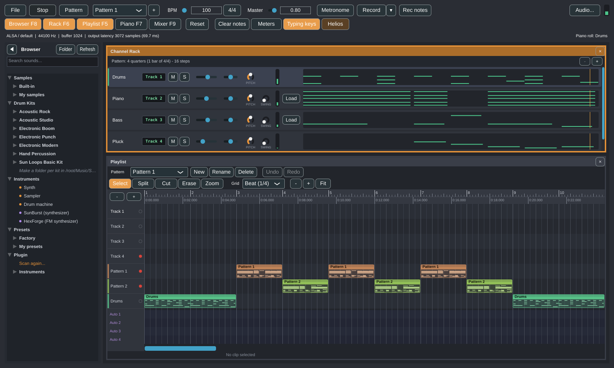
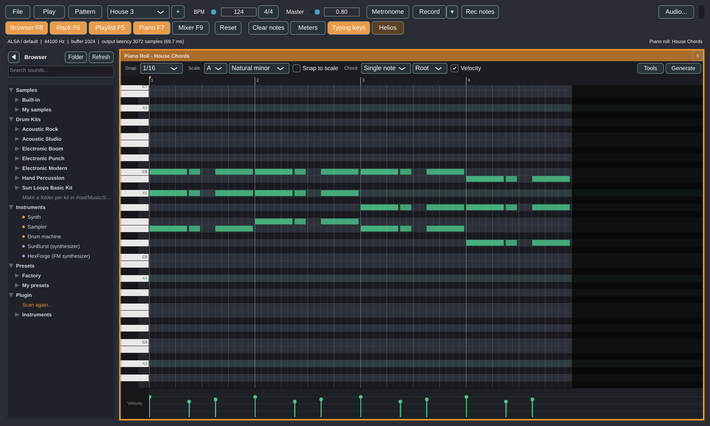
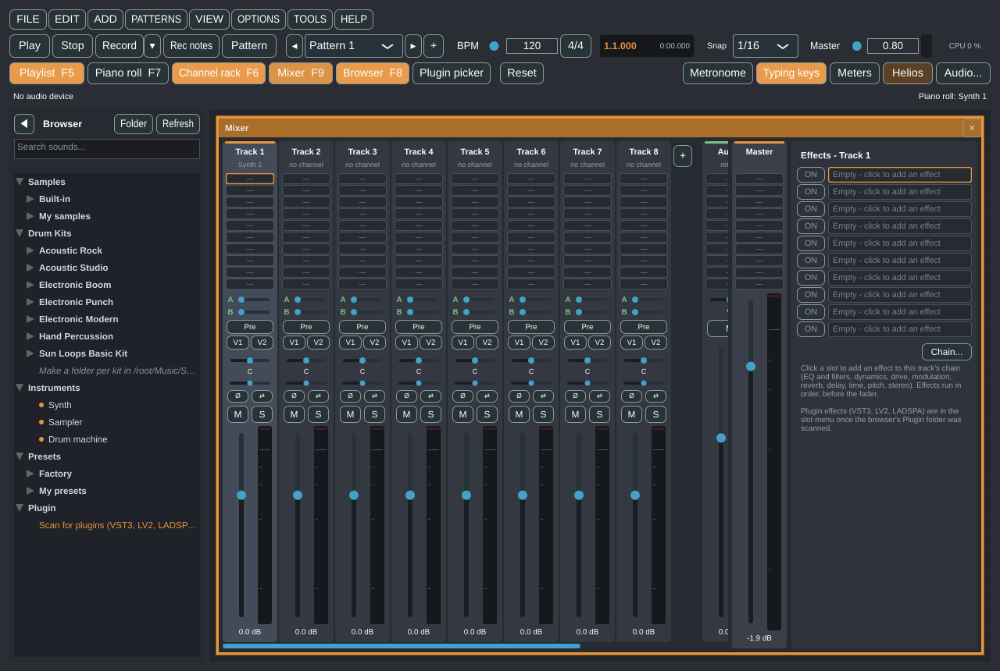
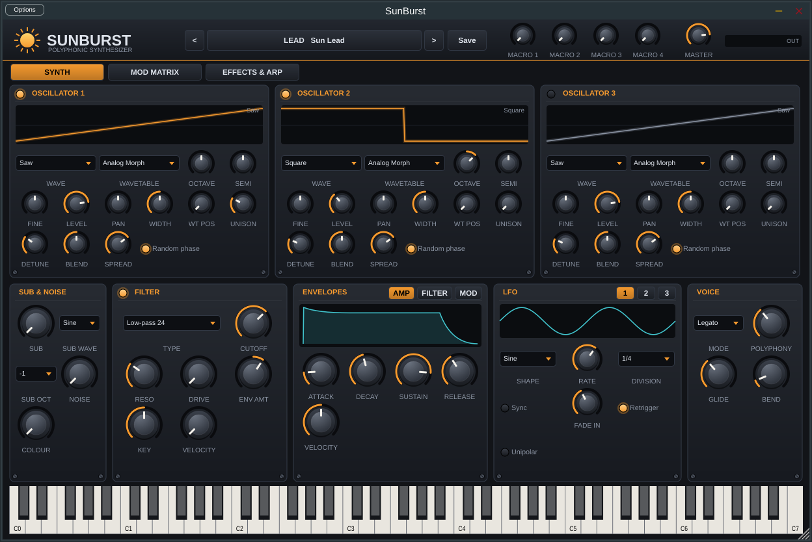
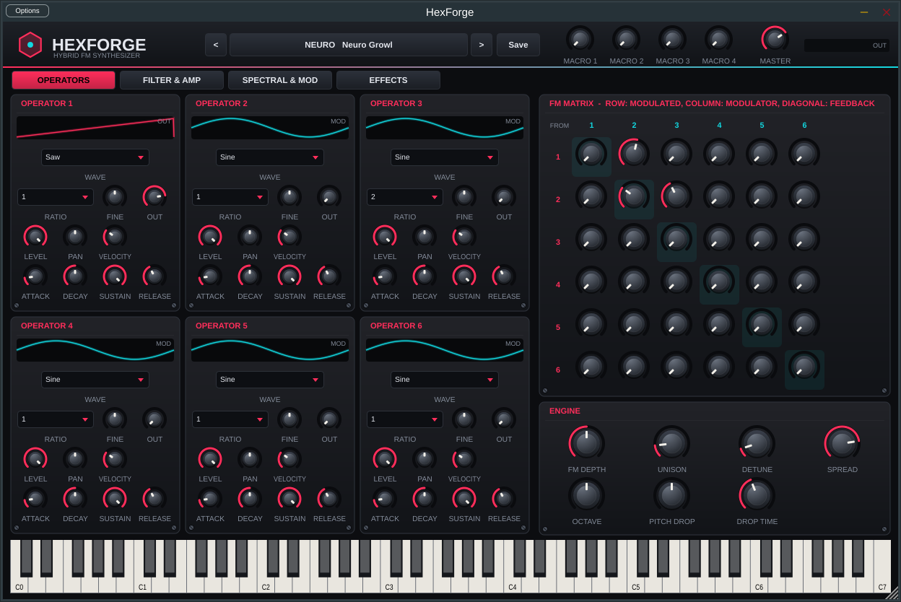

# Sun Loops Studio

*[Italiano](README.it.md)*

An open source, loop-based music production program for Linux, written in C++20 with JUCE 8. You build
beats and melodies in a **Channel Rack**, write notes in a **Piano Roll**, arrange patterns on a
**Playlist** (together with audio files and recordings), balance them in a **Mixer** with effects and export the result
to WAV, MP3, Ogg, AAC, FLAC or AIFF. A **Browser** on the left
holds your sounds; every other tool lives in a floating panel that you can move, resize, overlap, open and close.



| | |
| --- | --- |
|  |  |
| **Piano Roll** - scales, chords, velocity lane, editing tools and generators | **Mixer** - up to 500 tracks, 10 effect slots each, sends, aux buses, VCA groups |
|  |  |
| **SunBurst** - wavetable synthesizer, 101 presets (VST3 and Standalone) | **HexForge** - hybrid FM + subtractive synthesizer, 40 presets (VST3 and Standalone) |

## Download

Get the latest **AppImage** from the [Releases page](https://github.com/Hubert9204/Sun-Loops-Studio/releases/latest)
(`Sun-Loops-Studio-<version>-x86_64.AppImage`, one file with the program, its sounds and the SunBurst and HexForge synthesizers):

```bash
chmod +x Sun-Loops-Studio-*-x86_64.AppImage
./Sun-Loops-Studio-*-x86_64.AppImage
```

On Fedora / Nobara without FUSE 2, install it once (`sudo dnf install fuse-libs`) or start the AppImage with
`--appimage-extract-and-run`. The program checks for a newer release a few seconds after it starts (*File > Updates and crash reports > Check for updates now*
does it at once; the automatic check can be switched off) and its **Download** button fetches the new AppImage. Releases are
published since 0.51.0; to build from source see [Quick start](#quick-start-nobara--fedora).

Sun Loops Studio is inspired by the workflow of loop-based DAWs such as FL Studio. It is an independent project
that uses no code, names, graphics or assets from other products, and it is not affiliated with or endorsed by
their makers.

**Status: alpha (0.54.0).** It builds, more than 1,600 automated checks pass and every feature has been exercised in a virtual
display. The AppImage runs on Nobara; playback was first confirmed on a real Nobara machine with version 0.3. Most of what came
later (recording, MIDI hardware, plugins, the synthesizers' sound) was tested headless and in a virtual display with a silent audio
device, and is now being tried on real hardware. **Plugins (VST3, LV2, LADSPA)** work as instruments and as mixer effects since 0.17.0;
they were tried with small test plugins, the LADSPA examples and the program's own SunBurst and HexForge, not yet with commercial
plugins. See [docs/roadmap.md](docs/roadmap.md) for exactly what is and is not verified and what is missing.

## Features

- **Demo song** (0.52.0) - on its first start the program opens with "Sunrise Drive", 44 bars of synthwave that use SunBurst and HexForge, the
  sampled piano, bass and drums, the four synth engines, audio clips, insert effects, aux buses, VCA groups, a sidechain, automation
  and tempo changes. Press Space; *File > Open the demo song* brings it back. What plays where: [the user guide](docs/user-guide.md#projects).
- **Floating panels** - Channel Rack, Playlist, Piano Roll and Mixer. Drag by the title bar, resize from the
  edges, close with the x, double-click the title to maximise. Panels overlap; clicking one raises it.
  `F5` / `F6` / `F7` / `F9` open, raise or close the Playlist / Rack / Piano Roll / Mixer. The layout is remembered.
- **Browser** (left sidebar, `F8` folds it away) - a tree with *Samples*, *Drum Kits*, *Instruments*, *Presets* and
  *Plugin*, a quick-search box, and drag-and-drop (or double-click) of sounds onto a channel of the Channel Rack.
  Your own files live in `~/Music/Sun Loops Studio/`.
- **Channel Rack** - up to 32 channels, each a synth, a sampler or a drum machine. 16th-note step sequencer as in FL Studio
  (0.31.0): every new channel starts with squares (left click writes, right click erases); the grid is exactly the pattern - one bar
  of 4/4, 16 steps, in a new project - and the **-** / **+** buttons of the rack take away or add **one quarter** at a time (0.42.0); as soon as the Piano Roll
  writes other notes the row shows their preview (a click opens the Piano Roll), and clearing them brings the squares back. Per channel: volume, pan, a **Pitch** knob (semitones) and a **Swing** knob, and a
  **Track N** display that sends the channel to a mixer track. Right-click a channel for *Piano roll*, *Instrument*,
  *Load sample...*, *Rename...*, *Clone*, *Move up / down*, *Delete*, *Assign free mixer track*, *Save as preset...*.
- **Piano Roll** - for the selected channel: click to add a note, drag to move, drag the right edge to resize,
  right-click to delete, scroll and zoom. Opens from a channel (menu or double-click), as in FL Studio. **Since 0.23.0**: selections
  (a drag on empty cells draws a selection rectangle since 0.44.0; Ctrl+A), copy / paste / duplicate (also between channels' piano rolls), moving with the arrow keys, snap from bars to 1/32 and triplets, a **scale** shown on
  the grid (with snap to scale), **chords placed with one click**, a **velocity lane**, editing tools (quantize, humanize, legato,
  staccato, strum, arpeggiate, chop, flip, velocity ramps) and **generators** of chord progressions and basslines (also following the
  chords of another channel).
- **FL Studio projects** (0.34.0) - *File* opens a .flp as a new project (tempo, channels and their samples, pattern notes, the
  playlist, track names and colours) and exports one; the native format stays .slp. Written for this program, no FL Studio code.
- **Typing keyboard** (0.32.0) - the computer keyboard plays the selected channel: A S D F... from C5 (note names as in FL
  Studio, MIDI 60 = C5), Z / X for the octave, C / V for the velocity; recorded by Rec notes like a MIDI keyboard.
- **Loop Starter** (0.30.0) - a starting loop in one of ten genres (house, techno, hip-hop, trap, drum & bass, pop, lo-fi,
  reggaeton, rock, synthwave): drums, bass, chords and a melody that fit together, in the key you choose, at the genre's tempo, with the
  built-in sounds, as a new pattern. Made by rules and chance (no AI, nothing online); each variation is different.
- **Patterns and Playlist** - several patterns (new, cloned, renamed or deleted from buttons above the playlist), arranged
  as clips on tracks (0.44.0: 4 free tracks plus one per pattern, added automatically with each new pattern, and **-** / **+** to
  remove or add tracks by hand, up to 128; each with its own name and colour, and clips may lie over each other: 0.33.0); patterns are 4 to 64 quarters long, and pattern clips move by grid squares (or freely with Alt), so they can start out of step with each other (0.42.0). A *Pattern / Song* switch chooses between looping the selected pattern and playing the whole
  playlist. **Click the ruler to move the playhead, even while playing; right-drag on it to draw a loop region** (right-click it to move, resize or delete it).
- **Audio in the Playlist** - drag audio files (`.wav .aiff .flac .ogg .oga .mp3 .aac`) or video files (their sound
  track) from the file manager onto the Playlist: they become clips with a waveform. **Select, Split, Cut, Erase and Zoom
  tools**, trimming from both edges, a grid down to one tick, undo/redo and a ruler in minutes:seconds.milliseconds
  with a readout of the time under the mouse let you work on a take precisely. AAC and video sound need `ffmpeg` installed.
- **Recording** - the **Record** button records a microphone or an instrument into the playlist track you choose, in
  time with the song; **since 0.36.0** several tracks at once, each from its own input (mono or a stereo pair), and from the
  start marker (punch-in); **since 0.47.0** with a count-in, one take per pass of a loop region, or punch-out. **MIDI keyboards** play the selected channel, and **Rec notes** writes what they play into the piano roll
  (quantized) so you can make patterns; a take can also become a new sampler channel. Set up in **Audio...**.
- **Built-in sounds** (0.22.0) - a sampled **Grand Piano** (Salamander, 4 velocity layers), a sampled **Electric Bass** (Growlybass,
  4 velocity layers, plus a staccato version), two sampled **acoustic drum kits** (from the DrumGizmo recordings: Acoustic Studio and
  Acoustic Rock, 16 pieces with up to 4 velocity layers), three **electronic kits** and a **hand percussion** kit made by the
  program's code, all with velocity layers and in the General MIDI drum order. Presets > Factory > Keys / Bass; Drum Kits in the
  browser and in the drum machine's *Load kit...* menu. The demo song plays them; a start-up sound plays when the program opens
  (switch it off in the File menu). Licenses: [resources/sounds/README.md](resources/sounds/README.md).
- **MIDI import, legato and slide, note undo** - a Standard MIDI File (File menu, or dropped on the Playlist) becomes new
  channels and patterns; notes can be joined with **legato** or a pitch **slide** (Shift+click in the Piano Roll); **Ctrl+Z / Ctrl+Y**
  undo and redo any edit (notes, channels, kits, mixer, patterns; the Playlist also has its own clip undo).
- **Safety** - autosave every minute, recovery after a crash, a `.bak` of the previous version, and *Export project with samples* to move a
  project to another computer.
- **Metronome** - a click with adjustable tempo (and tap tempo) and volume, on its own button.
- **Time signature and tempo changes** (0.46.0) - 2/4 to 7/4, 6/8 and 12/8 for the bars, the grid and the metronome's accent; tempo
  changes in the song (steps, like FL Studio's tempo markers) shown as flags in the ruler and followed by Song mode and exports.
- **Mixer** (`F9`) - 8 vertical tracks to start with and up to **500** (0.29.0: the **+** after the last track adds more), each with a fader and dB read-out, stereo balance, mute, solo, a Peak/RMS
  meter and 10 insert-effect slots (0.45.0; with effect-chain presets) (14 built-in effects with presets: Equalizer, Parametric EQ, Filter, Compressor, Maximizer, Transient, Overdrive, Chorus, Phaser, Reverb with Hall/Room/Plate, Delay with Stereo/Ping-pong/Tape, Time Shaper (like Gross Beat), Pitch Corrector (like Pitcher), Stereo Imager; each with bypass), two **sends** (pre or post fader)
  and two **VCA** switches. Two **aux buses** with their own effects and two **VCA groups** sit beside the tracks. The master strip on the
  right has the same 10 effect slots, applied to the whole mix. The Compressor has a **sidechain** input from any track (0.45.0). Several channels can share a track.
- **Synth** - every synth channel can switch from the classic sine to a **subtractive synth**: two band-limited oscillators and noise, a 12 or
  24 dB filter with its own envelope, an amplitude envelope and an LFO, or to an **FM synth** with four operators and a modulation matrix
  (feedback, eight classic algorithms), to an **additive synth** (0.24.0: up to 64 harmonics, two timbres with formants and a morph
  between them, a filter acting on the harmonics so it never aliases) or to a **physical model** (0.24.0: a plucked string with damping,
  stiffness and a wooden body; marimba, vibraphone, glass, bell, metal plate); 29 ready-made sounds, grouped by engine (also as browser
  presets).
- **SunBurst** (0.48.0) - a polyphonic synthesizer plugin (VST3 and Standalone) included with the program: three oscillators with
  band-limited wavetables and up to 16 unison voices ("fat saw"), sub and noise, a multimode filter, three envelopes, three LFOs,
  a 16-slot modulation matrix, four macros, distortion / EQ / filter / chorus / delay / reverb, an arpeggiator, a hardware-style
  window and 101 presets (leads, pads, strings, basses, arps, plucks, keys, FX). Browser > Instruments > SunBurst.
- **HexForge** (0.50.0) - a hybrid FM + subtractive synthesizer plugin (VST3 and Standalone) for aggressive, metallic sounds:
  six operators with 32 band-limited waves and two drawable / loadable spectral waves, a 6 x 6 FM matrix in one panel, a
  Moog-style ladder filter with its own envelope and LFO, unison, pitch drop, effects and 40 presets (neuro, reese, dubstep,
  DnB, cyberpunk, dark synth, industrial, metal FX). Browser > Instruments > HexForge.
- **Plugins** - VST3, LV2 and LADSPA instruments and effects: scan them from the browser, double-click or drag an instrument for a channel,
  pick an effect in a mixer slot, open the plugin's own window; their settings are saved in the project, and a missing plugin keeps them.
- **Automation** - right-click a volume, pan, fader or effect parameter > *Create automation clip*; clips live on four lanes under the
  playlist tracks and have a point editor (linear / hold / smooth lines). Song mode only. **Since 0.35.0** also the parameters of
  VST3 / LV2 / LADSPA plugins, chosen from a filterable list with the one last moved in the plugin's window already selected.
  **Since 0.47.0** also sends, aux buses and VCA groups, and the controls move with their automation while the song plays.
- **Stretch and pitch** - right-click an audio clip: make it longer or shorter without changing its pitch, shift its pitch without changing its length,
  or match a loop to the project tempo (Signalsmith Stretch).
- **Sampler and SoundFonts** - envelope (ADSR), loop, low / high / band-pass filter and root key per sampler channel; **SoundFont 2 (.sf2)** presets and (since 0.41.0) **SFZ** instruments
  played as multi-sample zones; the sample editor's slices become a sampler channel with one note per slice.
- **Slicer** (0.37.0) - a loop cut into slices as in Slicex (by sound, by grid or in equal parts), one key per slice, each with its
  own pitch, level, pan and direction, and the notes that play it following the project's tempo.
- **Pitch editor** (0.38.0) - a sung or played line as notes over its pitch curve (as Newtone): move notes, tune them to the key
  or a scale, save the tuned audio, or turn the line into notes of a channel.
- **Stems** (0.39.0) - a mix split into drums, bass and the rest by signal processing (no AI), the three adding up to the original.
- **Helios** (0.40.0) - F1: ask how to do something in English or Italian; it searches the built-in manual and runs commands, offline.
- **Crash reports and updates** (0.43.0) - a session log (spdlog, rotated at 5 MB); after a crash (SIGSEGV, SIGABRT, SIGFPE...) the next start
  offers to send an anonymous report with the stack trace and system to GitHub as an issue (or to show it first, or to delete it); a
  background check for a newer release (Semantic Versioning), which can be switched off. Nothing is sent without a click.
- **Drum machine** - a channel with 16 pads (notes 36 to 51): up to four sound layers per pad chosen by velocity, level, pan, tuning, swing and
  choke groups per pad, a step sequencer with a row per pad, drag-and-drop from the browser, and kits saved as folders (`kit.json` + sounds).
- **Sample editor** - right-click an audio clip or a sampler channel > *Edit sample...*: waveform with zoom and selection, preview with a live spectrum,
  cut / crop / silence / reverse / invert / gain / normalise / fades / DC removal with undo, noise reduction (spectral gating), and slicing a clip at detected hits
  or equal parts. The result is saved as a new WAV file; the original is never touched.
- **Meters** - loudness in LUFS (momentary, short-term, integrated, range; EBU R128), true peak, spectrum analyser, goniometer and correlation.
- **Sampler** - loads WAV, FLAC, OGG and AIFF files (up to 30 s), plays them one-shot, repitched by note.
  Kick, snare and hat are synthesised, so you need no sample files to start.
- **Projects** - `File` menu and `Ctrl+N` / `Ctrl+O` / `Ctrl+S` / `Ctrl+Shift+S`: *Save* writes a named project;
  a project that has no name yet is saved at once under an automatic name (`Untitled <date time>.slp`) in
  `~/Music/Sun Loops Studio/Projects`, so nothing is lost; *Save as...* asks for a name. Open recent, a title bar
  that shows the name and `*` for unsaved changes, and a prompt before closing with unsaved work. Samples are
  referenced by path, not copied into the file.
- **Export** - *File > Export audio*: the pattern or the song as WAV, AIFF, FLAC (lossless) or MP3, Ogg Vorbis
  (`.ogg` / `.oga`), AAC (lossy), rendered by the same engine that plays it; since 0.45.0 with a choice of sample rate (44.1 - 96 kHz),
  bit depth (16 dithered, 24, 32 float) or bit rate, title and artist tags, and **stems** (one file per mixer track). MP3 and AAC need `ffmpeg`.
- **Audio** - device selection, an adjustable **buffer size** (default 1024 samples) and an **Auto** button that tests
  your computer and picks a size that does not crackle, plus a read-out of load and dropped blocks. The choice is
  remembered.

## Quick start (Nobara / Fedora)

```bash
git clone https://github.com/Hubert9204/Sun-Loops-Studio.git
cd Sun-Loops-Studio
./scripts/setup_nobara.sh                      # installs build dependencies (asks for sudo)
cmake -B build -G Ninja -DCMAKE_BUILD_TYPE=Release
cmake --build build
./build/SunLoopsStudio_artefacts/Release/"Sun Loops Studio"
```

The first configure downloads JUCE 8.0.4 (needs network once). To install into your menu:
`cmake --install build --prefix ~/.local`. To make a single-file **AppImage** (`dist/Sun-Loops-Studio-<version>-x86_64.AppImage`):
`./scripts/build_appimage.sh`. More detail, other distributions and troubleshooting:
[docs/building.md](docs/building.md).

Press **Space** to play, **F5 / F6 / F7 / F9** to show panels and **F8** for the browser. A guided tour is in
[docs/user-guide.md](docs/user-guide.md).

## Documentation

| Document | Contents |
| --- | --- |
| [docs/user-guide.md](docs/user-guide.md) | How to use every panel, shortcuts, limits ([Italiano](docs/user-guide.it.md)) |
| [docs/building.md](docs/building.md) | Dependencies, build, install, tests, troubleshooting |
| [docs/architecture.md](docs/architecture.md) | Threads, real-time rules, data flow, patterns and playlist, panels, tests |
| [docs/roadmap.md](docs/roadmap.md) | What is verified, what is not, what comes next |
| [CHANGELOG.md](CHANGELOG.md) | Changes per version |

## Tests

```bash
./build/SunLoopsStudioTests_artefacts/Release/SunLoopsStudioTests
```

Headless (no audio device or display needed), 1693 checks at 0.52.0. They cover, among other things, synth pitch and
sample-exact timing, every instrument and effect, that `Player::render` never allocates (effects included), a concurrent stress test of
the UI-to-audio hand-over, the project file (round trip, damaged and hostile files, missing samples, atomic writing), FL Studio and MIDI
import, export to every format, recording, automation, tempo changes, the plugin host, SunBurst and HexForge (presets, voices,
filters, effects, saved state) and the update check. GitHub Actions builds the program on Fedora and runs them on every push.

## License

Since 0.34.0 Sun Loops Studio is free software under the **GNU Affero General Public License, version 3** (AGPLv3,
[LICENSE](LICENSE)); versions 0.17.0 to 0.33.0 were published under the GNU GPL version 3 and versions up to 0.16.0 under MIT.
JUCE 8, which the program is built on, is itself offered for free under the AGPLv3, so the two now match. The program and its
AppImage can be shared as long as the source comes with them; if you change the program and let people use it over a network
(for example a remote control), you must offer them the source of your version too (section 13 of the license).

The FL Studio project support (`src/library/FlpFile.*`, `FlpProject.*`) is code written for this program under the same
license; it uses no FL Studio code or library, only the file layout as documented by the free-software community.

`third_party/signalsmith` holds Signalsmith Stretch and Signalsmith Linear, both MIT-licensed (their licences and the exact revisions are in that folder).
`third_party/tinysoundfont` holds TinySoundFont's `tsf.h` (MIT), used only to read SoundFont files.
The built-in recordings keep their own licenses: Salamander Grand Piano by Alexander Holm (CC BY 3.0), Growlybass by Karoryfer Lecolds
(CC0), DrumGizmo MuldjordKit by Lars Muldjord and DRSKit by the DrumGizmo team (CC BY 4.0); see
[resources/sounds/README.md](resources/sounds/README.md) and [tools/sounds](tools/sounds/README.md) for how they were prepared.
