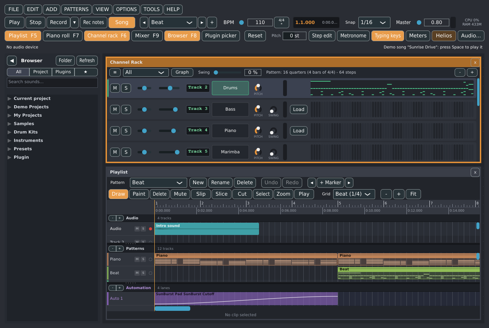
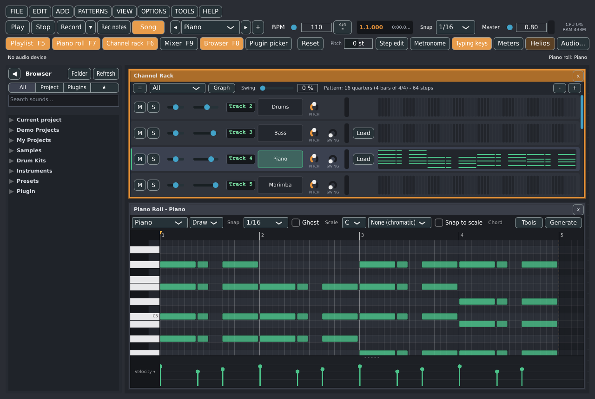
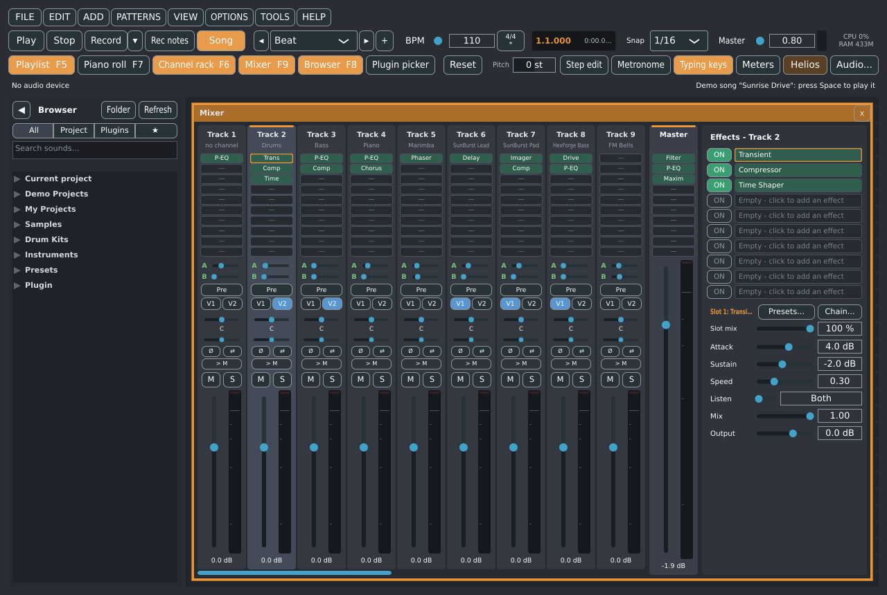
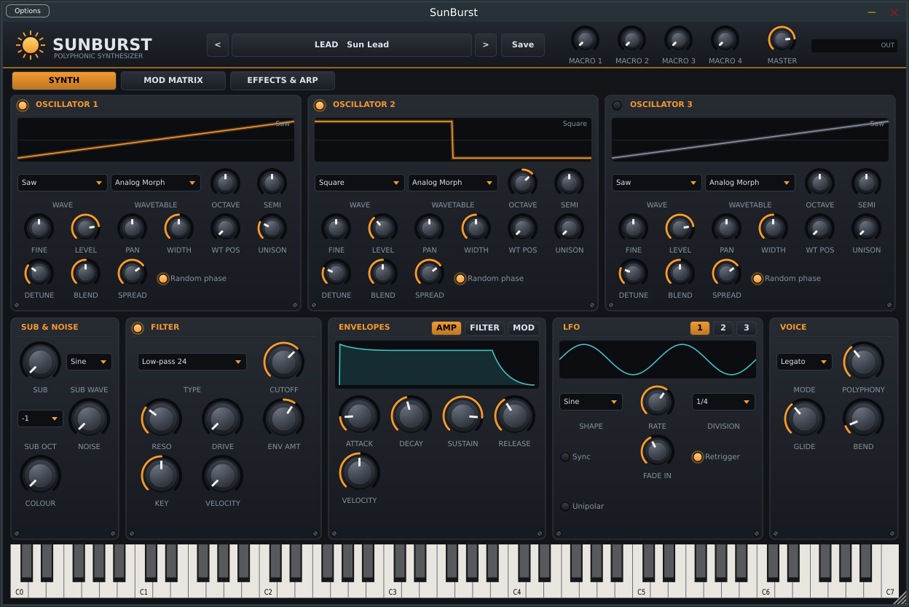
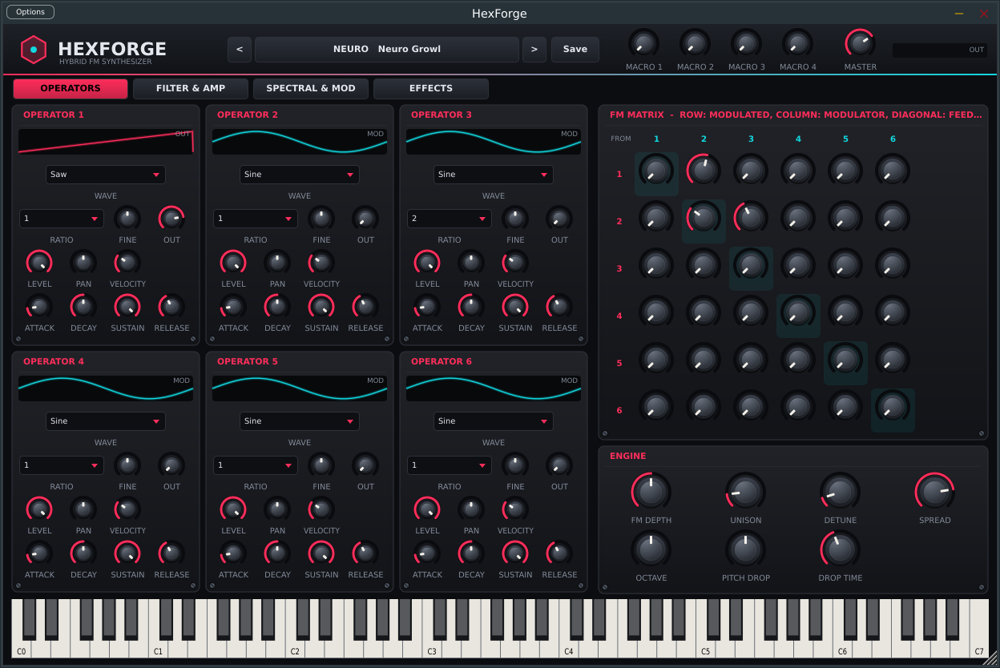
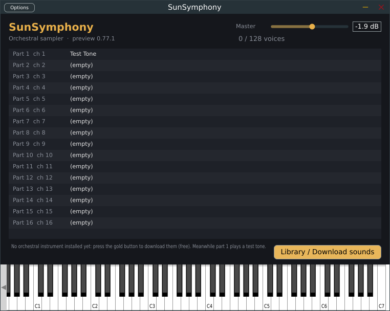
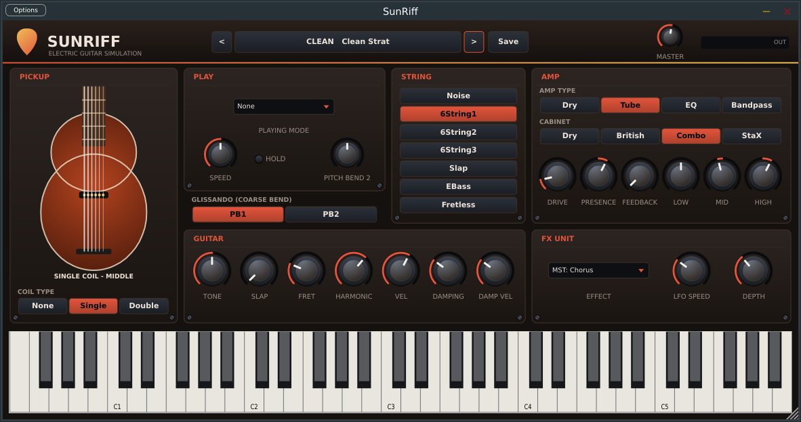

# Sun Loops Studio

*[Italiano](README.it.md)*

An open source, loop-based music production program for **Linux, macOS and Windows**, written in C++20 with JUCE 8. You build
beats and melodies in a **Channel Rack**, write notes in a **Piano Roll**, arrange patterns, audio and automation on a
**Playlist**, balance them in a **Mixer** with effects and export the result to WAV, MP3, Ogg, AAC, FLAC or AIFF. A **Browser**
on the left holds your sounds; every other tool lives in a floating panel that you can move, resize, overlap, open and close.
Four instruments come with it: the **SunBurst** and **HexForge** synthesizers, the **SunRiff** electric guitar and the
**SunSymphony** orchestral sampler.



| | |
| --- | --- |
|  |  |
| **Piano Roll** - scales, chords, velocity and event lanes, editing tools, generators | **Mixer** - up to 500 tracks, 10 effect slots each, sends, aux buses, VCA groups |
|  |  |
| **SunBurst** - wavetable synthesizer, 101 presets | **HexForge** - hybrid FM + subtractive synthesizer, 40 presets |
|  |  |
| **SunSymphony** - orchestral sampler, 16 parts, 29 downloadable instruments | **SunRiff** - modelled electric guitar with amp and effects, 34 presets |

## Download

The latest release for all three systems ([all files, checksums and older versions](https://github.com/Hubert9204/Sun-Loops-Studio/releases/latest)):

| System | Download | Needs |
| --- | --- | --- |
| **Linux** | [Sun-Loops-Studio-x86_64.AppImage](https://github.com/Hubert9204/Sun-Loops-Studio/releases/latest/download/Sun-Loops-Studio-x86_64.AppImage) | 64-bit PC, glibc 2.40 or newer (Fedora / Nobara 41+, Ubuntu 24.10+, Debian 13+, Arch...) |
| **macOS** | [Sun-Loops-Studio-macOS.dmg](https://github.com/Hubert9204/Sun-Loops-Studio/releases/latest/download/Sun-Loops-Studio-macOS.dmg) | macOS 10.15 Catalina or newer; one app for Apple silicon and Intel Macs (from 2012 on) |
| **Windows** | [Sun-Loops-Studio-Windows-x64-Setup.exe](https://github.com/Hubert9204/Sun-Loops-Studio/releases/latest/download/Sun-Loops-Studio-Windows-x64-Setup.exe) (installer) or [Sun-Loops-Studio-Windows-x64.zip](https://github.com/Hubert9204/Sun-Loops-Studio/releases/latest/download/Sun-Loops-Studio-Windows-x64.zip) (no installation) | Windows 10 or 11, 64-bit |

These links always give the newest release. On the release page the same files carry the version in their name
(`Sun-Loops-Studio-<version>-x86_64.AppImage`...), next to `SHA256SUMS*.txt` with their checksums. Every download holds the program,
its sounds and its four instruments; SunSymphony's orchestra (3 GB) is downloaded from inside it.

**Linux** - make the AppImage executable and start it:

```bash
chmod +x Sun-Loops-Studio-x86_64.AppImage
./Sun-Loops-Studio-x86_64.AppImage
```

Without FUSE 2 it does not start: install it once (Fedora / Nobara: `sudo dnf install fuse-libs`; Ubuntu / Debian: `sudo apt
install libfuse2t64` or `libfuse2`) or start it with `--appimage-extract-and-run`. At its first start it adds itself to the
applications menu and gives `.slp` project files its icon.

**macOS** - open the disk image and drag **Sun Loops Studio** onto **Applications**. The app is not signed with an Apple Developer
certificate, so the first time macOS refuses to open it: right-click (or Control-click) the app > **Open** > **Open**, or *System
Settings > Privacy & Security > Open Anyway* (the only way on macOS 15 Sequoia and newer). Recording asks once for the microphone.
More: [On a Mac](docs/user-guide.md#on-a-mac-0630).

**Windows** - the installer installs for you alone without an administrator password (or for everyone, if you choose so), adds a
Start menu entry, opens `.slp` projects with a double-click and can copy the four instruments into the VST3 folder for other
music programs; *Settings > Apps* uninstalls it. The zip is the same program without installing: unpack it anywhere and start
`Sun Loops Studio.exe`. The program is not signed with a code-signing certificate, so SmartScreen may stop the first start:
**More info** > **Run anyway**. Audio interfaces are opened through their **ASIO** driver by default (Windows Audio when there is
none). More: [On Windows](docs/user-guide.md#on-windows-0750).

The program checks for a newer release a few seconds after it starts (*Help > Check for updates now* does it at once; the
automatic check can be switched off) and offers the download for your system. To build it yourself see
[Building from source](#building-from-source).

**Community:** join the [Sun Loops Discord](https://discord.gg/VwzdD6tRNB) to ask questions, report problems and share your music
(also from the program: *Help > Join the Sun Loops Discord*).

Sun Loops Studio is inspired by the workflow of loop-based DAWs such as FL Studio. It is an independent project that uses no
code, names, graphics or assets from other products, and it is not affiliated with or endorsed by their makers.

## Status

**Alpha - version 0.77** (November 2026). It is usable for making music, but not yet tried widely on real hardware.

- **Automated tests**: about **2,130 checks** pass on every push on all three systems - Fedora 41, macOS (Apple silicon, and
  Intel through Rosetta) and Windows - in GitHub Actions. On Windows the continuous integration also starts the program from the
  zip, installs, starts and uninstalls it with the installer, and loads a real ASIO driver (FlexASIO).
- **Linux** is where the program was made: the AppImage runs on Nobara and playback was confirmed on a real machine. Most later
  features (recording, MIDI hardware, plugins, the instruments' sound) were tested headless and in a virtual display with a silent
  audio device.
- **macOS** (since 0.63.0) and **Windows** (since 0.75.0, ASIO since 0.76.0) are built from the same code and pass the same tests,
  but have not yet been tried by hand on real computers; reports are welcome.
- **Plugins** were tried with small test plugins, the LADSPA examples and the program's own four instruments, not yet with
  commercial plugins.

What is and is not verified, feature by feature: [docs/roadmap.md](docs/roadmap.md). Changes per version: [CHANGELOG.md](CHANGELOG.md).

## Features

### Making music

- **Channel Rack** - up to 32 channels, each a synth, a sampler, a drum machine, a layer of other channels or a plugin. A
  16th-note step sequencer as in FL Studio, with a graph editor per step (velocity, pan, release, fine pitch, mod X / Y, shift), groups,
  colours, icons, per-channel volume, pan, pitch, swing and a mixer track.
- **Piano Roll** - draw, paint, mute, slice and playback tools, selections; snap from bars to 1/32 and triplets; a **scale** on the grid,
  **chords** in one click, **velocity** and event lanes (pan, release, fine pitch, mod X / Y), quantize, humanize, legato,
  strum, arpeggiate, chop, flip, glue, flam, claw machine, and **generators** of chord progressions and basslines. Typing keys
  and MIDI keyboards play and record into it.
- **Patterns and Playlist** - patterns of their own length, arranged on a Playlist in three sections (**Audio**, **Patterns**,
  **Automation**; one track per pattern, added and deleted with it) with draw, paint, delete, mute, slip, slice, cut, select, playback and zoom tools, time markers, a loop region, track
  mute / solo, icons and colours. *Pattern* or *Song* playback.
- **Audio clips and recording** - drag audio (`.wav .aiff .flac .ogg .oga .mp3 .aac`) or the sound of a video onto the Playlist;
  stretch and pitch them (Signalsmith Stretch), edit them in the **sample editor** (cut, fades, reverse, normalise, noise
  reduction, slicing). **Record** several inputs at once into the playlist, with count-in, loop takes, punch in / out, and MIDI
  notes in overdub or replace.
- **Automation** - clips for any volume, pan, fader, send, effect or plugin parameter (aux buses included), the channels' pitch and
  swing, mute and solo, the master volume and pitch, with a point editor, the controls moving with it as the song plays; tempo changes and
  time signatures from 2/4 to 12/8.
- **Performance mode** - the Playlist's clips as cells to launch live (loop, one shot, hold), from the mouse or MIDI pads.
- **Loop Starter** - a starting loop in one of ten genres (drums, bass, chords and melody), made by rules and chance, offline.
- **FL Studio and MIDI files** - open and export `.flp` projects (written for this program, no FL Studio code); import Standard
  MIDI Files. The native format is `.slp`.

### Sound

- **Built-in synth engines** - subtractive, 4-operator FM, additive, physical modelling (strings, mallets, bells) and a **drum
  synth** (kick, snare, tom, clap, hi-hat, cymbal), with ready-made sounds.
- **Sampler** - ADSR and per-target envelopes, two LFOs, filters, loops, reverse, **granular** and **travel-curve** play modes, a
  **speech synthesizer** that turns typed text into a sample; **SoundFont 2** and **SFZ** instruments; a **slicer**; a **drum
  machine** with 16 pads and velocity layers; a **pitch editor** for sung lines; **stems** (drums, bass, the rest) by signal
  processing.
- **Built-in sounds** - a sampled Grand Piano and Electric Bass, two sampled acoustic drum kits, three electronic kits and a hand
  percussion kit ([licences](resources/sounds/README.md)).
- **Mixer** - 8 to 500 tracks (add at the end, delete any one: everything routed to the others follows), each with fader, pan, stereo separation, polarity, mute / solo, meters, **10 effect slots** with a
  mix knob, 8 sends (pre or post fader), free routing, a track delay and plugin delay compensation; up to eight aux buses (+ and - in the mixer) and two VCA
  groups; a master strip.
- **36 built-in effects and controllers** - EQs, filters, compressors and a multiband compressor, maximizer, gate, overdrive,
  wave shaper, chorus, flanger, phaser and their vintage versions, delays, reverbs and a convolution reverb, vocoder, pitch
  corrector, time shaper, scratcher, granular, frequency shifter, stereo imager, the **Patcher** (ten effects in one slot) and
  peak, envelope and formula controllers. With presets and chain presets.
- **Meters** - loudness in LUFS (EBU R128), true peak, spectrum, goniometer and correlation.
- **Export** - the pattern or the song as WAV, AIFF, FLAC, MP3, Ogg Vorbis or AAC, 44.1 - 96 kHz, 16 / 24 / 32-bit, with tags,
  and **stems** (one file per mixer track). MP3 and AAC need `ffmpeg`.

### The four instruments

| Instrument | What it is |
| --- | --- |
| **SunBurst** (0.48.0) | Polyphonic wavetable synthesizer: 3 oscillators with up to 16 unison voices, sub and noise, multimode filter, 3 envelopes, 3 LFOs, a 16-slot modulation matrix, 4 macros, effects, arpeggiator, 101 presets |
| **HexForge** (0.50.0) | Hybrid FM + subtractive synthesizer for aggressive, metallic sounds: 6 operators, 32 waves plus 2 drawable spectral waves, a 6 x 6 FM matrix, ladder filter, unison, effects, 40 presets |
| **SunSymphony** (0.66.0, preview) | Multitimbral orchestral sampler: 16 parts on the 16 MIDI channels, 128 voices, SFZ instruments; its Library page downloads 29 orchestral instruments (3 GB, CC0 sounds by Versilian Studios) with one click |
| **SunRiff** (0.68.0) | Electric guitar with FL Slayer's controls: physically modelled strings, a movable pickup, chord, strum, power-chord and slide modes, a tube amp, 4 cabinets, 15 effects, 34 presets |

**How they are built.** Each instrument is a plugin of its own, not code compiled into the program: `CMakeLists.txt` makes each
with `juce_add_plugin(... FORMATS VST3 Standalone)`, which gives two CMake targets per instrument - `SunBurst_VST3` and
`SunBurst_Standalone` (likewise `HexForge_*`, `SunSymphony_*`, `SunRiff_*`) - switched on by default with `SLS_BUILD_SUNBURST`,
`SLS_BUILD_HEXFORGE`, `SLS_BUILD_SUNSYMPHONY` and `SLS_BUILD_SUNRIFF`. Building the program (`SunLoopsStudio`) builds the four
**VST3** plugins too, and the program loads them like any other VST3 plugin, from next to itself and without a scan (Browser >
Instruments). Their DSP code is also compiled into the test program, to be tested headless.

- **In the downloads**: the four **VST3** plugins - inside the AppImage (`usr/lib/vst3`), inside the Mac app
  (`Contents/PlugIns/VST3`) and in the Windows program's `VST3` folder (the installer can also copy them into the system's VST3
  folder for other music programs). The **Standalone** versions are not in the downloads.
- **From source**: `cmake --build build --target SunBurst_Standalone` (or `HexForge_Standalone`...) makes the Standalone program,
  in `build/SunBurst_artefacts/Release/Standalone/`; the VST3 bundles are in `build/<Instrument>_artefacts/Release/VST3/`, ready
  to copy into another program's VST3 folder (`~/.vst3` on Linux).

### Help, safety and the rest

- **Helios** (F1) - ask how to do something in English or Italian: it searches the built-in manual and runs commands, offline.
  **LLM mode** turns it into a chat with a language model (Google's Gemma 4, downloaded once) that runs on your computer and
  never touches the project.
- **Demo song and demo projects** - "Sunrise Drive" opens on the first start; three more finished songs are in the browser.
- **Plugins** - hosts VST3 and LV2 on every system, LADSPA on Linux and Audio Units on macOS, as instruments and as effects, with
  a Plugin picker and their settings saved in the project.
- **Safety** - autosave every minute, recovery after a crash, the 10 previous versions in a `Backups` folder, *Export project with samples*
  as a folder or a single `.slpz` file.
- **Crash reports and updates** - after a crash the next start offers to send an anonymous report (stack trace and system) as a
  GitHub issue; a background check for newer releases. Nothing is sent without a click.
- **Audio** - ALSA, JACK and PipeWire on Linux, Core Audio on macOS, ASIO, Windows Audio (WASAPI) and DirectSound on Windows; an
  adjustable buffer with an **Auto** button that finds a size that does not crackle; MIDI keyboards switched on as they are
  plugged in.
- **Interface** - FL Studio's layout of menus, toolbar and panels; F5 / F6 / F7 / F8 / F9 for Playlist, Channel Rack, Piano Roll,
  Browser and Mixer; the computer keyboard as a piano; a saved layout.

Everything above is described in detail in the [user guide](docs/user-guide.md) ([Italiano](docs/user-guide.it.md)).

## Building from source

On Nobara / Fedora:

```bash
git clone https://github.com/Hubert9204/Sun-Loops-Studio.git
cd Sun-Loops-Studio
./scripts/setup_nobara.sh                      # installs build dependencies (asks for sudo)
cmake -B build -G Ninja -DCMAKE_BUILD_TYPE=Release
cmake --build build
./build/SunLoopsStudio_artefacts/Release/"Sun Loops Studio"
```

The first configure downloads JUCE 8.0.4, spdlog, nlohmann/json and llama.cpp (needs network once). `cmake --install build
--prefix ~/.local` installs it into your menu; `./scripts/build_appimage.sh` makes the AppImage. On a Mac
`./scripts/build_macos.sh` makes the universal `.dmg`; on Windows `scripts\build_windows.ps1` makes the installer and the zip
(Visual Studio with its Clang, and Inno Setup). Every dependency, other distributions, the CMake options and troubleshooting:
[docs/building.md](docs/building.md) ([macOS](docs/building.md#macos-0630), [Windows](docs/building.md#windows-0750)).

Press **Space** to play, **F5 / F6 / F7 / F9** to show panels and **F8** for the browser. A guided tour is in
[docs/user-guide.md](docs/user-guide.md).

## Documentation

| Document | Contents |
| --- | --- |
| [docs/user-guide.md](docs/user-guide.md) | How to use every panel, shortcuts, limits ([Italiano](docs/user-guide.it.md)) |
| [docs/building.md](docs/building.md) | Dependencies, build on Linux, macOS and Windows, install, tests, releases, troubleshooting |
| [docs/architecture.md](docs/architecture.md) | Threads, real-time rules, data flow, patterns and playlist, panels, tests |
| [docs/roadmap.md](docs/roadmap.md) | What is verified, what is not, what comes next |
| [docs/fl-studio-alignment.md](docs/fl-studio-alignment.md) | Every module compared with its FL Studio counterpart |
| [CHANGELOG.md](CHANGELOG.md) | Changes per version |

The screenshots on this page are made by [scripts/capture_screenshots.sh](scripts/capture_screenshots.sh) in a virtual display
(the *Screenshots* workflow runs it).

## Tests

```bash
./build/SunLoopsStudioTests_artefacts/Release/SunLoopsStudioTests
```

Headless (no audio device or display needed); about 2,130 checks at 0.77.0. They cover, among other things, synth pitch and
sample-exact timing, every instrument and effect, that `Player::render` never allocates, a concurrent stress test of the
UI-to-audio hand-over, the project file (round trip, damaged and hostile files, missing samples, atomic writing), FL Studio and
MIDI import, export to every format, recording, automation, tempo changes, the plugin host, the four instruments, crash reports
(in a child process, on each system), the update check and, on Windows, ASIO. GitHub Actions runs them on every push on Fedora,
macOS and Windows.

## License

Since 0.34.0 Sun Loops Studio is free software under the **GNU Affero General Public License, version 3** (AGPLv3,
[LICENSE](LICENSE)); versions 0.17.0 to 0.33.0 were published under the GNU GPL version 3 and versions up to 0.16.0 under MIT.
JUCE 8, which the program is built on, is itself offered for free under the AGPLv3, so the two match. The program and its
downloads can be shared as long as the source comes with them; if you change the program and let people use it over a network
(for example a remote control), you must offer them the source of your version too (section 13 of the license).

The FL Studio project support (`src/library/FlpFile.*`, `FlpProject.*`) is code written for this program under the same
license; it uses no FL Studio code or library, only the file layout as documented by the free-software community.

Third-party code:

- `third_party/signalsmith` - Signalsmith Stretch and Signalsmith Linear (MIT; licences and revisions in that folder).
- `third_party/tinysoundfont` - TinySoundFont's `tsf.h` (MIT), used only to read SoundFont files.
- Helios's helper `sun-loops-helios` is built with llama.cpp (MIT; its licence is in `third_party/llama.cpp` and goes with every
  copy of the helper). The Gemma 4 models (Google, Apache License 2.0) are not part of the program: LLM mode downloads them
  from Hugging Face when asked.
- Windows only: Steinberg's **ASIO SDK** (used under the GPLv3; ASIO is a trademark of Steinberg Media Technologies GmbH) and
  **libcurl** (curl licence) are built in; their licences are shipped next to the program (`LICENSE-ASIO-SDK.txt`,
  `LICENSE-curl.txt`).

The built-in recordings keep their own licenses: Salamander Grand Piano by Alexander Holm (CC BY 3.0), Growlybass by Karoryfer
Lecolds (CC0), DrumGizmo MuldjordKit by Lars Muldjord and DRSKit by the DrumGizmo team (CC BY 4.0); see
[resources/sounds/README.md](resources/sounds/README.md) and [tools/sounds](tools/sounds/README.md) for how they were prepared.
